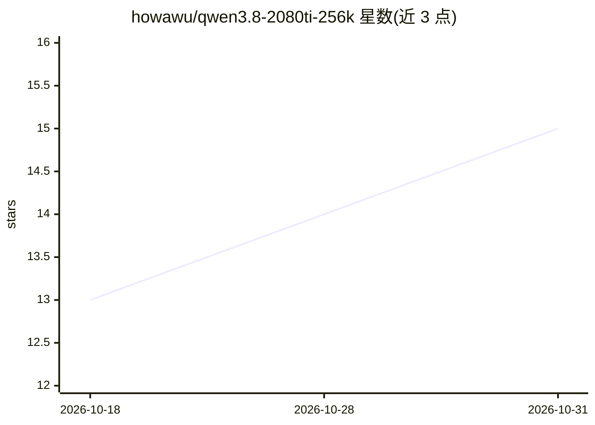

# howawu/qwen3.8-2080ti-256k

⭐ 15 · PowerShell · MIT · 推送 2026-09-21 · [GitHub](https://github.com/howawu/qwen3.8-2080ti-256k) · 个人维护 · 中文 README

**在 RTX 2080 Ti 22GB 上部署 Qwen3.8-27B 256K 上下文的配置方案仓库**

面向单张魔改 22 GB RTX 2080 Ti 的本地部署配方：文档化两种启动模式——Mode A 用上游 llama.cpp + DFlash2 1.9B 投机草稿跑 128K 日常负载，Mode B 用 KVMem 引擎（112,640 token 物理 KV 工作集 + 检索旧块）实现 256K 逻辑上下文，另含 n-gram 重复上下文复用。仓库不分发权重与二进制，以 PowerShell 启动脚本和可重放的 patch 目录发布，需自行下载 GGUF、克隆并编译 KVMem 引擎。README 给出显存布局、测量数字及其声明边界。

## 筛选速览

| 维度 | 判定 | 备注 |
|---|---|---|
| AI 角色 | `ai-ecosystem` | LLM/agent 周边工具 |
| 许可风险 | `permissive` | MIT |
| 部署形态 | `desktop` | 安装包/桌面程序 |
| 模型依赖 | local-ok | 支持本地模型 |
| 硬件要求 | `gpu-8g` | |
| 安装摩擦 | `low` | 无编译、无系统依赖或容器化 |
| 成熟度 | — | 结构信号不足 |

## 能力要点

- 两种模式一键切换：llama.cpp+DFlash2（128K）与 KVMem（256K 逻辑上下文）
- n-gram 复用使重复代码请求从 70.39 提至 227.65 tok/s 中位数
- KVMem 以 112,640-token GPU 工作集 + 检索支撑 256K 逻辑上下文
- 完整记录启动参数、显存布局与复现陷阱（docs/LAUNCH_PARAMS.md）

## 适用场景

- 在老 Turing 显卡上单卡跑 27B 模型并保留长上下文
- 本地低延迟日常使用与长文档处理按需切换模式
- 复现并调优 DFlash2 投机解码与 n-gram 复用的部署参数

## 场景标签

`推理引擎` · 领域:训练与推理

## 证据(README 行号)

> L33: |**A**|upstream llama.cpp + DFlash2|131,072|`scripts/start-llama.ps1`|daily driver: lowest latency per token, most 
> L97: - Mode B: the KVMem engine — clone upstream and replay the two patches in `patches/` (one command on Windows: `scri

## 星数曲线

2026-10-18 13 → 2026-10-31 15（+2）

---
*卡片 v1 · prompt 1.4 · 生成 2026-10-30 · 置信度 high · 依据 README sha `e8be07b7ebcc` · [字段定义](../../DATASET.md)*
