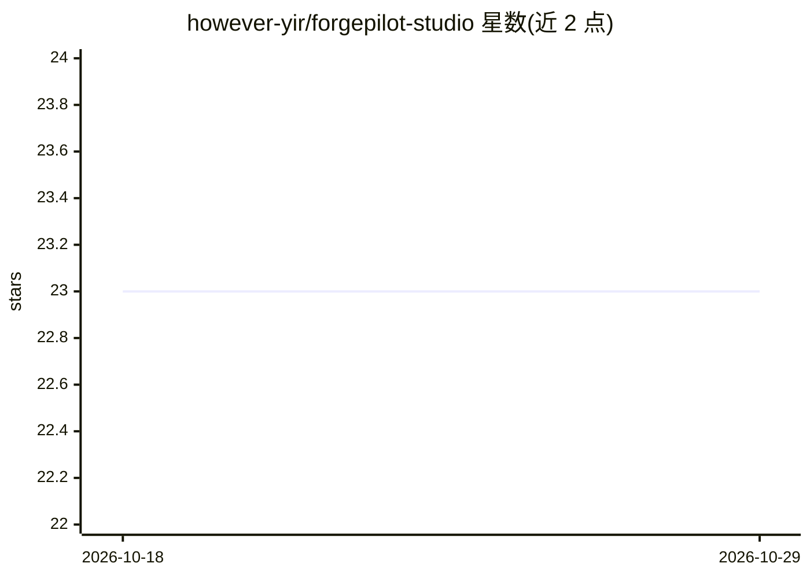

# however-yir/forgepilot-studio

⭐ 23 · Python · MIT · 推送 2026-08-28 · [GitHub](https://github.com/however-yir/forgepilot-studio) · [官网](https://github.com/however-yir/forgepilot-studio/tree/main/docs) · 个人维护 · 中文 README

**面向研发团队的可审计 AI 工程执行工作台（OpenHands 深度分叉）**

基于 OpenHands 深度分叉的 AI 工程执行平台，继承其 Agent 与 runtime 基础，自研控制平面（Plan→Execute→Verify→Report）、任务台、审计回放、MCP 工具管理、团队权限与成本阈值等治理层。支持多模型接入（OpenAI 兼容网关、Ollama、本地模型）、CLI/本地控制台/容器/Kubernetes 四种运行形态。README 明确声明：治理组件目前为实验性模块，尚未接入默认执行链路，默认执行路径仍走上游 OpenHands 流程，仅有审计导出等少量端点在生产路由暴露。

## 筛选速览

| 维度 | 判定 | 备注 |
|---|---|---|
| AI 角色 | `ai-native` | 本体是模型或模型工具 |
| 许可风险 | `permissive` | MIT |
| 部署形态 | `self-host` | docker 或自建部署 |
| 模型依赖 | local-ok | 支持本地模型 |
| 硬件要求 | — | 无带数字的原话,不猜 |
| 安装摩擦 | `low` | 无编译、无系统依赖或容器化 |
| 成熟度 | `idea` | |

## 能力要点

- Plan→Execute→Verify→Report 控制平面任务协议（实验性）
- 模型响应、命令、文件修改、工具调用统一进入可追溯时间线并可导出 JSONL/CSV
- 支持 OpenAI 兼容网关、Ollama、本地模型与私有网关接入
- CLI、本地控制台、容器、Kubernetes 多运行形态

## 适用场景

- 研发团队以任务台方式运行 AI 工程执行并回放审计轨迹
- 私有化部署带模型预算与权限边界的 Agent 平台
- 通过 MCP、脚本插件把 Agent 接入团队内部系统

## 场景标签

`编码 Agent` `Agent 框架` `LLM 可观测性` · 领域:Agent 开发

## 证据(README 行号)

> L8: > **OpenHands 深度分叉 (deep fork)，在 Agent 与 runtime 基础上自研：**
> L22: ForgePilot Studio 把”创建任务 → 执行命令 → 修改代码 → 验证测试 → 审计回放”收束成团队可治理的工程执行链路。它是 OpenHands 的深度分叉 (deep fork)，继承 Agent 与 runt
> L69: - 工程任务执行：命令运行、代码编辑、补丁生成、验证闭环。

## 星数曲线

2026-10-18 23 → 2026-10-29 23（+0）

---
*卡片 v1 · prompt 1.4 · 生成 2026-10-27 · 置信度 high · 依据 README sha `6e66f092d38d` · [字段定义](../../DATASET.md)*
