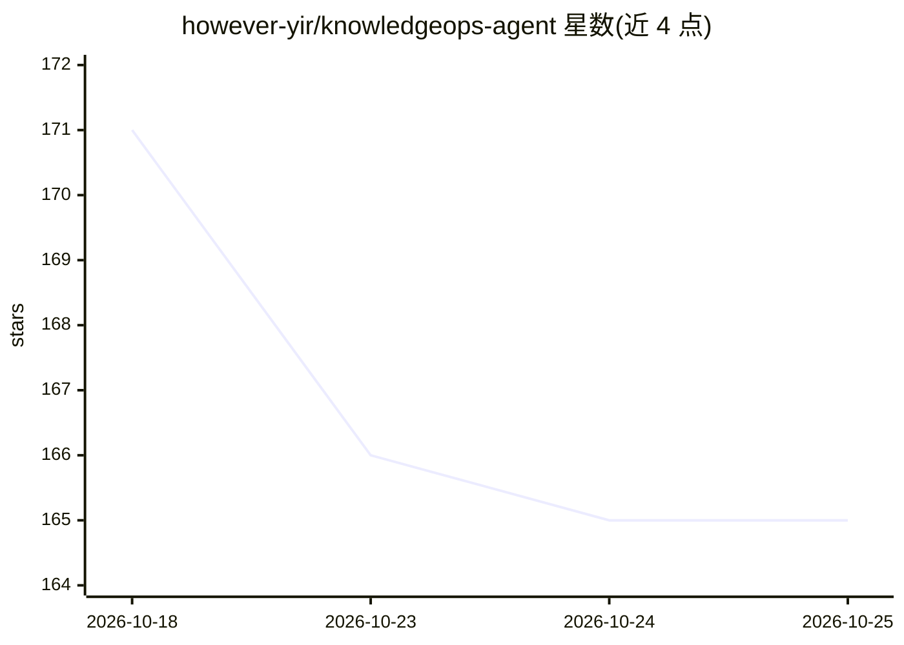

# however-yir/knowledgeops-agent

⭐ 165 · Java · MIT · 推送 2026-09-21 · [GitHub](https://github.com/however-yir/knowledgeops-agent) · [官网](https://github.com/however-yir/knowledgeops-agent/tree/main/docs) · 个人维护 · 中文 README

**企业 Spring AI RAG 平台原型：多 Agent、混合检索、租户隔离与可观测**

基于 Spring AI（锁定 1.0.0-M6 基线）构建的生产导向平台原型，面向需要企业知识库/智能客服基线的后端开发者。提供 Agent 工作流状态机、DeepResearch 深度研究、向量+关键词+图谱+Web 四路混合检索与融合排序、证据三维评分与编号引用、长短期记忆持久化、异步入库队列（Redis Stream/RabbitMQ，含重试与 DLQ）、JWT/API Key/RBAC 租户隔离与审计、Prometheus/Loki/Tempo 可观测栈。Docker Compose 一键启动，含 Vue3 前端控制台与 RAG Evaluation Studio。限制：README 自述为平台原型而非生产验证成品，Spring AI 迁移至 1.1.x 尚在计划中，限流为单实例内存实现，记忆服务暂无 REST Controller。

## 筛选速览

| 维度 | 判定 | 备注 |
|---|---|---|
| AI 角色 | `ai-ecosystem` | LLM/agent 周边工具 |
| 许可风险 | `permissive` | MIT |
| 部署形态 | `self-host` | docker 或自建部署 |
| 模型依赖 | — | README 未给出锁定关系 |
| 硬件要求 | — | 无带数字的原话,不猜 |
| 安装摩擦 | `low` | 无编译、无系统依赖或容器化 |
| 成熟度 | `idea` | |

## 能力要点

- AgentWorkflowEngine 状态机与 agent_task/step/event 事件溯源持久化
- 四路混合检索（pgvector/关键词/知识图谱/Web）融合排序与证据评分引用
- API Key+JWT+RBAC 租户隔离、审计日志与敏感信息脱敏
- Docker Compose 全栈部署与 Prometheus/Loki/Tempo/Alertmanager 观察栈

## 适用场景

- 搭建企业内部知识库的 PDF 入库与带引用的检索问答
- 以平台为底座构建智能客服等业务 Agent 应用
- 需要租户隔离、权限审计与可观测运维的 AI 后端基线

## 场景标签

`RAG` `多智能体` `文档问答` · 领域:Agent 开发

## 证据(README 行号)

> L14: KnowledgeOps Agent is a production-oriented platform prototype built on Spring AI. It combines **Agent Workflow Eng
> L92: KnowledgeOps Agent 是 however-yir AI 工程作品矩阵中的 **”多 Agent + RAG + 记忆 + 图谱的企业 AI 平台”**，作为 **tianji-ai-agent（智能客服/课程顾问）
> L96: |**KnowledgeOps Agent**|多 Agent + RAG + 记忆 + 图谱的企业 AI 平台|提供 RAG/记忆/图谱/DeepResearch API|

## 星数曲线

2026-10-18 171 → 2026-10-25 165（-6）

---
*卡片 v1 · prompt 1.4 · 生成 2026-10-22 · 置信度 high · 依据 README sha `d7f0477cbabc` · [字段定义](../../DATASET.md)*
