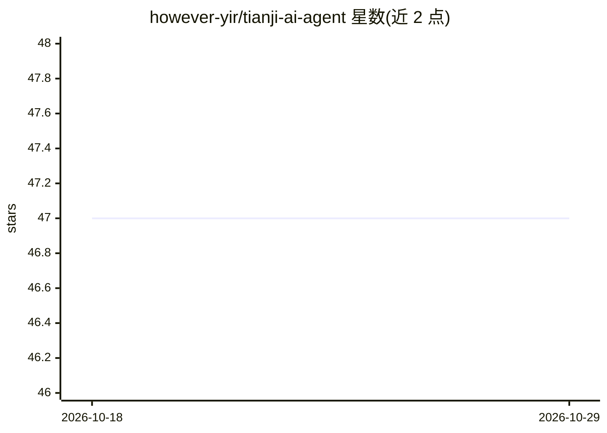

# however-yir/tianji-ai-agent

⭐ 47 · Java · MIT · 推送 2026-08-29 · [GitHub](https://github.com/however-yir/tianji-ai-agent) · [官网](https://github.com/however-yir/tianji-ai-agent/tree/main/docs) · 个人维护 · 中文 README

**面向生产的多 Agent 课程顾问应用：治理、评测与 SSE 全链路**

基于 Java/Spring Boot/Spring AI 的多 Agent 在线课程业务应用，覆盖课程推荐、咨询、预下单、售后、投诉与转人工。核心机制：LLM 只提出业务动作，由 AgentHarness 确定性策略（动作白名单、执行预算、循环检测、幂等去重）决定执行；支付/越权/注入动作统一拒止并兜底转人工。提供 160 例离线路由契约评测、无 LLM 一键验收、golden run 回放与 CI 质量门禁，SSE 事件契约贯穿前后端。快速开始支持 docker compose 与 dev-demo 模式，外部客服系统与外部 LLM 密钥为可选集成。

## 筛选速览

| 维度 | 判定 | 备注 |
|---|---|---|
| AI 角色 | `ai-native` | 本体是模型或模型工具 |
| 许可风险 | `permissive` | MIT |
| 部署形态 | `self-host` | docker 或自建部署 |
| 模型依赖 | — | README 未给出锁定关系 |
| 硬件要求 | — | 无带数字的原话,不猜 |
| 安装摩擦 | `low` | 无编译、无系统依赖或容器化 |
| 成熟度 | — | 结构信号不足 |

## 能力要点

- LLM 提议 + 确定性策略治理：支付/越权/注入动作在 Runtime 前拒止
- 160 例离线路由契约评测（98.75% accuracy、0 unsafe route）与无 LLM 一键验收
- SSE 七类事件契约（ROUTE/TRACE/PARAM 等）贯穿后端与 React 前端
- 执行预算、幂等去重（InMemory/Redis）、Run Record 可回放证据

## 适用场景

- 搭建课程推荐/咨询/预下单的智能客服 Agent 业务闭环
- 参考确定性动作治理与 AgentOps 证据链的工程实践
- 用离线评测与 CI 门禁回归验证 Agent 路由安全性

## 场景标签

`多智能体` `模型评测` `聊天机器人` · 领域:Agent 开发

## 证据(README 行号)

> L3: > **Production-oriented multi-agent course advisor with deterministic action governance, bounded execution, offline 
> L5: > 这不是框架 Demo 或 AI 技术合集，而是一个围绕课程推荐、咨询、预下单、售后与转人工的可运行业务 Agent 案例。
> L47: `tianji-ai-agent` 不再定位为“学习型 AI 工程合集”，而是一个围绕在线课程业务搭建的智能体样板项目。它要讲清楚一件事：当用户说“我想学 Java，帮我推荐并下单”时，系统如何完成意图识别、课程查询、订单预确认、

## 星数曲线

2026-10-18 47 → 2026-10-29 47（+0）

---
*卡片 v1 · prompt 1.4 · 生成 2026-10-25 · 置信度 high · 依据 README sha `4c31dc555eda` · [字段定义](../../DATASET.md)*
