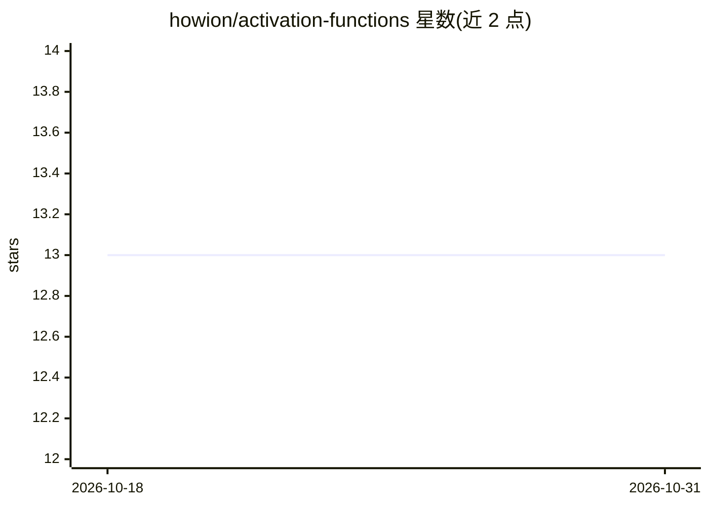

# howion/activation-functions

⭐ 13 · TypeScript · MIT · 推送 2026-04-22 · [GitHub](https://github.com/howion/activation-functions) · 个人维护

**零依赖的 TypeScript 神经网络激活函数库，附论文出处**

以 TypeScript 编写、零运行时依赖的神经网络激活函数集合：覆盖 ReLU/GELU/Swish/Mish/SELU 等 40 余种函数，按基础、有界平滑、振荡、整流与现代激活、收缩算子、Sigmoid 族等类别组织，多数条目附带原始论文引用（含 arXiv 与会议出处）。实现注明数值稳定性处理（SoftPlus 阈值回退、LogSigmoid 稳定式、Erf 有理逼近误差约 1.5e-7）。以 npm 包形式提供，供在 JS/TS 中构建或实验神经网络的开发者使用。

## 筛选速览

| 维度 | 判定 | 备注 |
|---|---|---|
| AI 角色 | `ai-ecosystem` | LLM/agent 周边工具 |
| 许可风险 | `permissive` | MIT |
| 部署形态 | `library` | 以包/库形式分发 |
| 模型依赖 | — | README 未给出锁定关系 |
| 硬件要求 | — | 无带数字的原话,不猜 |
| 安装摩擦 | `low` | 无编译、无系统依赖或容器化 |
| 成熟度 | — | 结构信号不足 |

## 能力要点

- 40 余种激活函数，零依赖 TypeScript 实现
- 多数函数附原始论文引用（含 SELU 官方常数）
- 数值稳定性处理：SoftPlus 阈值回退、LogSigmoid 稳定式、Erf 有理逼近（误差约 1.5e-7）
- 提供导数版本（dELU、dSiLU）与别名导出（Sigmoid/SoftStep/Swish1）

## 适用场景

- 在 TypeScript/JavaScript 神经网络实现中引入激活函数
- 查阅各激活函数的原始论文出处
- 需要数值稳定的 sigmoid/softplus 计算时直接复用

## 场景标签

 · 领域:机器学习/数学库

## 证据(README 行号)

> L8: A small, dependency-free collection of common neural-network activation functions, most of them with references to t
> L24: import { ReLU, Sigmoid, Swish, ... } from "activation-functions"

## 星数曲线

2026-10-18 13 → 2026-10-31 13（+0）

---
*卡片 v1 · prompt 1.4 · 生成 2026-10-31 · 置信度 high · 依据 README sha `7be8bb5af138` · [字段定义](../../DATASET.md)*
