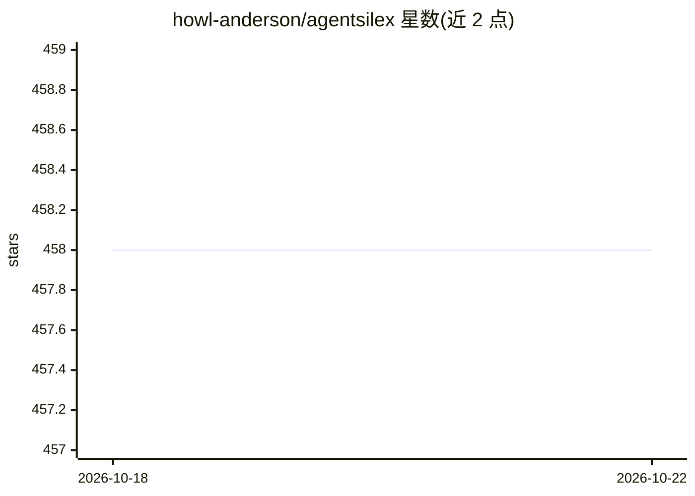

# howl-anderson/agentsilex

⭐ 458 · Python · MIT · 推送 2026-01-02 · [GitHub](https://github.com/howl-anderson/agentsilex) · [官网](https://github.com/howl-anderson/agentsilex) · 个人维护

**约 300 行代码的可读可改 Python agent 框架**

面向希望理解 agent 内部机制的开发者、教育者与研究者的 Python agent 框架：核心实现约 300 行，提供 Agent/Runner/Session/@tool 抽象，支持工具调用、多 agent handoff、结构化输出（Pydantic）、流式响应、MCP 客户端与 OpenTelemetry 追踪。模型接入基于 LiteLLM，可切换 OpenAI、Anthropic、Google、DeepSeek、Azure 及本地 LLM 等 100+ 模型。附带 agent 评测框架（工具轨迹、响应匹配、LLM-as-judge）。异步支持、状态持久化等仍在路线图中。

## 筛选速览

| 维度 | 判定 | 备注 |
|---|---|---|
| AI 角色 | `ai-ecosystem` | LLM/agent 周边工具 |
| 许可风险 | `permissive` | MIT |
| 部署形态 | `library` | 以包/库形式分发 |
| 模型依赖 | — | README 未给出锁定关系 |
| 硬件要求 | — | 无带数字的原话,不猜 |
| 安装摩擦 | `low` | 无编译、无系统依赖或容器化 |
| 成熟度 | — | 结构信号不足 |

## 能力要点

- 核心实现约 300 行，可一次读完并自行修改
- 基于 LiteLLM 支持 100+ 模型（OpenAI/Anthropic/Gemini/DeepSeek/本地 LLM）
- 多 agent handoff、agent 转工具、MCP 客户端支持
- 内置 OpenTelemetry 追踪与 agent 评测框架

## 适用场景

- 学习 agent 框架的底层实现机制
- 企业需要一个可定制、可 fork 的 agent 基础框架
- 研究者快速原型化新的 agent 架构

## 场景标签

`Agent 框架` `多智能体` `模型评测` · 领域:Agent 开发

## 证据(README 行号)

> L8: A transparent, minimal, and hackable agent framework for developers who want full control.
> L19: - **Universal LLM Support**: Built on LiteLLM, seamlessly switch between 100+ models - OpenAI, Anthropic, Google Ge

## 星数曲线

2026-10-18 458 → 2026-10-22 458（+0）

---
*卡片 v1 · prompt 1.4 · 生成 2026-10-21 · 置信度 high · 依据 README sha `4247e80a6a08` · [字段定义](../../DATASET.md)*
