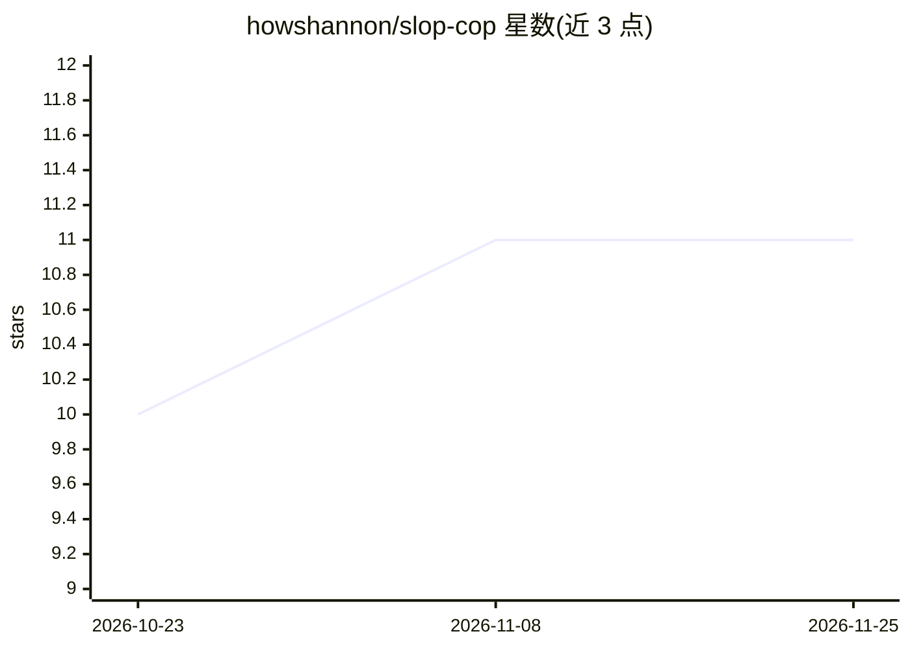

# howshannon/slop-cop

⭐ 11 · Python · MIT · 推送 2026-11-23 · [GitHub](https://github.com/howshannon/slop-cop) · 个人维护

**面向 agent 的文风/设计/代码去模板化审查技能**

以 Claude Code / Codex / Cursor 等 agent 技能形式分发的内容质量控制工具：审查散文、社媒文案、UI/设计与代码中的模板化模式（含糊主张、重复修辞、生成式界面默认值、happy-path-only 代码等），输出包含确定性 0–100 评分、字母等级、证据引证与修改建议的报告卡，支持审计、评分、改写、工单四种模式。通过 npx skills CLI 安装，明示不判断作者是否为人类。

## 筛选速览

| 维度 | 判定 | 备注 |
|---|---|---|
| AI 角色 | `ai-ecosystem` | LLM/agent 周边工具 |
| 许可风险 | `permissive` | MIT |
| 部署形态 | `library` | 以包/库形式分发 |
| 模型依赖 | — | README 未给出锁定关系 |
| 硬件要求 | — | 无带数字的原话,不猜 |
| 安装摩擦 | `low` | 无编译、无系统依赖或容器化 |
| 成熟度 | — | 结构信号不足 |

## 能力要点

- 确定性评分机制：固定扣分项（Blocker−30/Major−15/Minor−5/Note−1），同结论同分
- 覆盖 prose、UI/design、code 三个审查维度，按需加载对应参考资料
- 支持 Audit/Grade/Rewrite/Ticket 四种输出模式
- 反过度执法机制：排除引用、专名、代码示例等区域，区分个人风格与缺陷

## 适用场景

- 发布前给社媒文案或草稿评分并按建议修改
- 审查落地页是否有生成式界面默认套路与无依据指标
- 检查 AI 生成代码的 swallowed failures、缺失校验与弱测试
- 在保留原有语气的前提下改写机器腔文案

## 场景标签

`AI 写作` `代码审查` · 领域:编码与开发

## 证据(README 行号)

> L5:  Editorial quality control for prose, UI/design, and code.
> L12: ## Install
> L121: Compatible agents may select Slop Cop when a request matches its description. Explicit invocation is the most reli

## 星数曲线

2026-10-23 10 → 2026-11-25 11（+1）

---
*卡片 v1 · prompt 1.4 · 生成 2026-11-18 · 置信度 high · 依据 README sha `4e5259968da0` · [字段定义](../../DATASET.md)*
