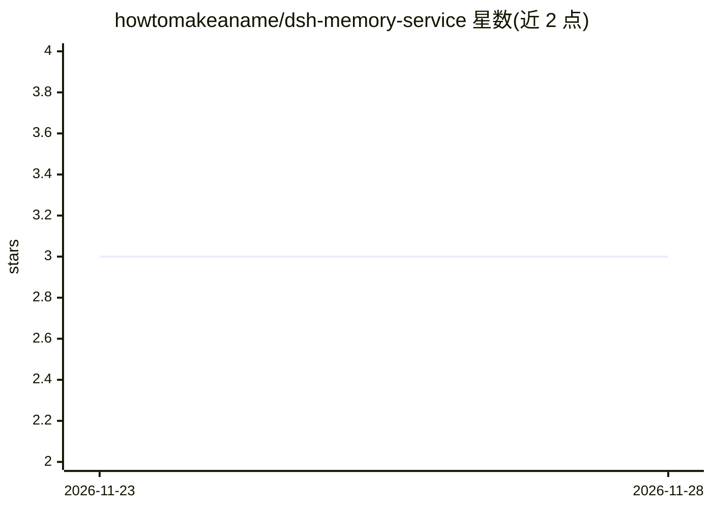

# howtomakeaname/dsh-memory-service

⭐ 3 · JavaScript · MIT · 推送 2026-11-21 · [GitHub](https://github.com/howtomakeaname/dsh-memory-service) · [官网](https://www.npmjs.com/package/dsh-memory-service) · 个人维护 · 中文 README

**给 DeepSeek Harness 编码 agent 提供跨会话长期记忆的插件**

以 DSH 插件形式提供的长期记忆层：每条记忆为带 frontmatter 的 Markdown 文件（唯一真源），SQLite FTS5 仅作可重建的检索索引；抽取使用宿主模型，无需向量数据库或 API key。提供 workspace/global 双作用域、revision 乐观并发与冲突标记、每轮按 token 预算注入相关记忆，并向宿主注册 9 个 memory_* 工具，另带侧栏记忆面板、CLI 与 Claude Code 记忆导入。要求 Node.js >= 22.5，需 DSH base+headless/desktop 插件 bundles。

## 筛选速览

| 维度 | 判定 | 备注 |
|---|---|---|
| AI 角色 | `ai-ecosystem` | LLM/agent 周边工具 |
| 许可风险 | `permissive` | MIT |
| 部署形态 | `library` | 以包/库形式分发 |
| 模型依赖 | locked-api |  |
| 硬件要求 | — | 无带数字的原话,不猜 |
| 安装摩擦 | `low` | 无编译、无系统依赖或容器化 |
| 成熟度 | — | 结构信号不足 |

## 能力要点

- Markdown 文件为唯一真源，SQLite FTS5 索引可从文件重建
- 向宿主注册 9 个 memory_* 工具（搜索/保存/更新/遗忘/冲突处理等）
- revision 乐观并发、supersedes 审计链与显式冲突标记
- 从 Claude Code workspace/global memory 的 review-first 迁移导入

## 适用场景

- 让编码 agent 在新会话中记住工程约定和架构决策
- 跨项目保存用户偏好并每轮自动注入
- 把已有的 Claude Code 记忆迁移到 DSH
- 以 Markdown 文件形式审计、编辑和备份 agent 记忆

## 场景标签

`Agent 记忆` · 领域:Agent 开发

## 证据(README 行号)

> L5: **为 DeepSeek Harness 提供文件原生、可审计、可重建的长期记忆。**
> L16: > dsh-memory-service 给 DSH 增加一层持久记忆：Markdown 文件是唯一真源，SQLite FTS5 只是可丢弃的检索索引，模型每轮只拿到和当前任务相关的那部分记忆。
> L115: 插件向宿主注册 9 个工具：

## 星数曲线

2026-11-23 3 → 2026-11-28 3（+0）

---
*卡片 v1 · prompt 1.4 · 生成 2026-11-23 · 置信度 high · 依据 README sha `5c67b668a84f` · [字段定义](../../DATASET.md)*
