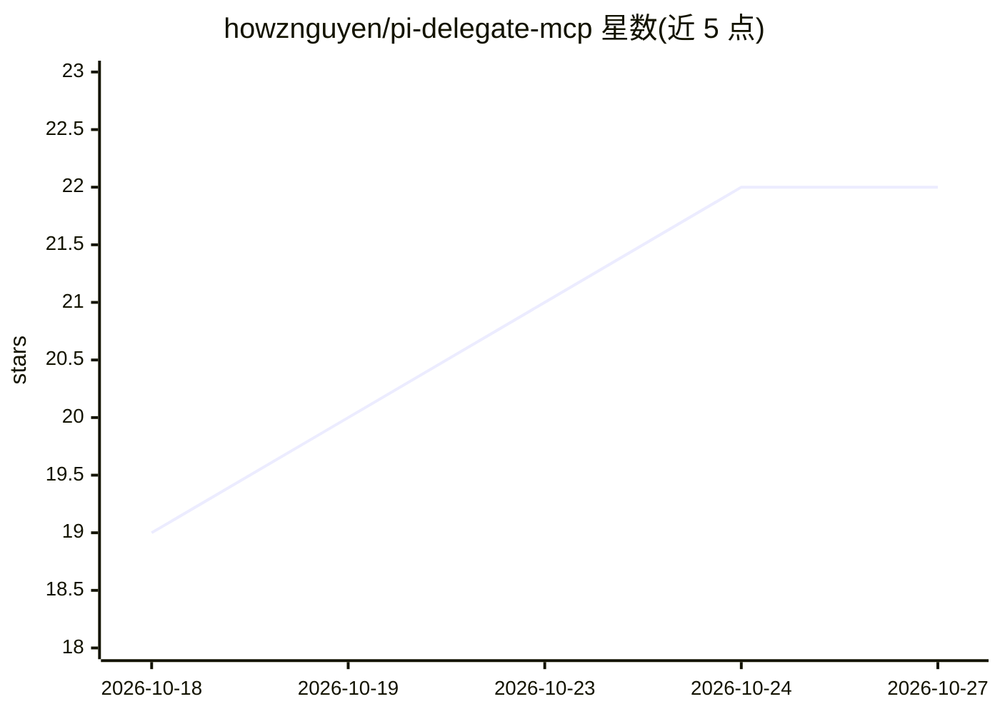

# howznguyen/pi-delegate-mcp

⭐ 22 · TypeScript · MIT · 推送 2026-10-14 · [GitHub](https://github.com/howznguyen/pi-delegate-mcp) · [官网](https://www.npmjs.com/package/pi-delegate-mcp) · 个人维护

**把 pi coding agent 变成可中途转向的 MCP 后台委派工人的服务器**

一个 MCP server，通过 pi 的 createAgentSession 在进程内持有会话，把 pi coding agent 暴露为可委派、可转向的后台工作者。提供 spawn/run/steer/follow_up/answer 等 12 个工具，支持批量子代理（最多 10 个）、按调用选择模型（DeepSeek/GLM/Kimi/Qwen/本地 llama.cpp 等约 38 个 provider）。子代理默认只读（read/grep/find/ls），其读取内容不进入主对话上下文。要求 Node.js 22.19+ 与已登录的 pi 安装。

## 筛选速览

| 维度 | 判定 | 备注 |
|---|---|---|
| AI 角色 | `ai-ecosystem` | LLM/agent 周边工具 |
| 许可风险 | `permissive` | MIT |
| 部署形态 | `library` | 以包/库形式分发 |
| 模型依赖 | — | README 未给出锁定关系 |
| 硬件要求 | — | 无带数字的原话,不猜 |
| 安装摩擦 | `low` | 无编译、无系统依赖或容器化 |
| 成熟度 | — | 结构信号不足 |

## 能力要点

- steer 可在运行中转向子代理，answer 应答其阻塞提问
- 子代理默认只读（read/grep/find/ls），会话构造时强制执行
- spawn_batch 一次最多 10 个子代理，批前整体验证
- status 返回有序 toolCalls 追踪，参数与结果可裁剪

## 适用场景

- 让贵模型主机把 grep、读大文件等杂活委派给便宜模型
- 并行派发多个子代理做仓库审计再统一查看
- 对已完成子代理追问而不重读文件

## 场景标签

`编码 Agent` `多智能体` · 领域:Agent 开发

## 证据(README 行号)

> L12: MCP server that exposes the pi coding agent as a **delegable, steerable** worker.
> L14: Point Claude Code (or any MCP host) at it and delegate work to any of pi's ~38 providers
> L58: pi ships `createAgentSession` as an embeddable library. This server holds the session object

## 星数曲线

2026-10-18 19 → 2026-10-27 22（+3）

---
*卡片 v1 · prompt 1.4 · 生成 2026-10-27 · 置信度 high · 依据 README sha `718a4de7ff0a` · [字段定义](../../DATASET.md)*
