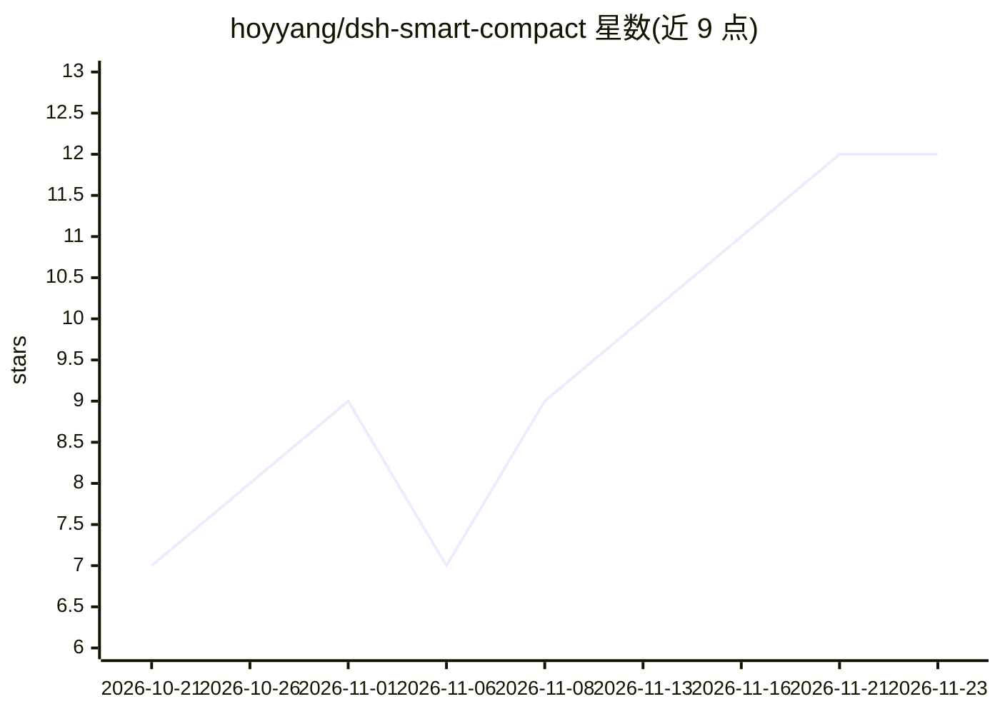

# hoyyang/dsh-smart-compact

⭐ 12 · TypeScript · BSD-3-Clause · 推送 2026-11-09 · [GitHub](https://github.com/hoyyang/dsh-smart-compact) · [官网](https://www.npmjs.com/package/dsh-smart-compact) · 个人维护 · 中文 README

**DeepSeek Harness 的上下文窗口自动换窗插件**

以 dsh 插件形式提供的上下文窗口管理引擎：窗口接近阈值时执行零模型调用的机械换窗，旧窗口事件原样归档、可按 seq 逐字回读，新窗口以 Task:/Last action: 锚点交接，配合 ctx_notes 笔记与 ctx_history 检索回查。提供 quiet/grace/forced 三带自动触发、预算读取、人工命令与按钮入口、锚点脱敏及 engine-state.json 观测账本。要求 dsh >= 0.1.5-rc，压缩服务单槽，与官方 compaction-basic 互斥接管，升级 dsh 后需重跑 npm install 重建。

## 筛选速览

| 维度 | 判定 | 备注 |
|---|---|---|
| AI 角色 | `ai-ecosystem` | LLM/agent 周边工具 |
| 许可风险 | `permissive` | BSD-3-Clause |
| 部署形态 | `library` | 以包/库形式分发 |
| 模型依赖 | — | README 未给出锁定关系 |
| 硬件要求 | — | 无带数字的原话,不猜 |
| 安装摩擦 | `low` | 无编译、无系统依赖或容器化 |
| 成熟度 | — | 结构信号不足 |

## 能力要点

- 零模型调用换窗，旧窗口 100% 无损归档并支持逐字回读
- 三带自动换窗与预算方程阈值（默认 ratio 0.75，低于官方引擎 0.8）
- ctx_notes 五操作工作笔记与 ctx_history 全文检索/按 seq 回读
- 自动生成锚点强制脱敏手机号/邮箱/证件号/企业名

## 适用场景

- 长编码会话快满窗口时自动换窗不中断任务
- 跨会话接力时从交接锚点与笔记精确续接
- 复盘中按关键词检索并逐字回读历史会话事件
- 会话中途切换 provider 时保证触发线按最新模型窗口计算

## 场景标签

`Agent 记忆` · 领域:Agent 开发

## 证据(README 行号)

> L5: **给 DeepSeek Harness 装上"自己管上下文窗口"的能力：窗口快满时零模型调用地换一张新窗，旧内容 100% 无损存档、随时逐字回查。**
> L16: ## 安装 Install
> L40: - **三带自动换窗（v0.6.0）**：quiet → grace 提醒 → forced 自动换窗，宿主事件驱动，阈值统一 0.75（含 provider 覆盖）。

## 星数曲线

2026-10-21 7 → 2026-11-23 12（+5）

---
*卡片 v1 · prompt 1.4 · 生成 2026-11-18 · 置信度 mid · 依据 README sha `03f160987097` · [字段定义](../../DATASET.md)*
