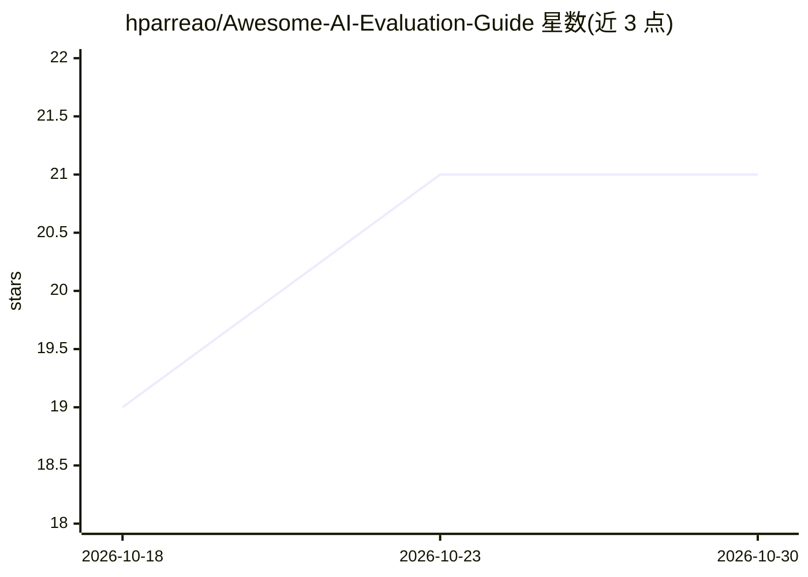

# hparreao/Awesome-AI-Evaluation-Guide

⭐ 21 · Python · CC0-1.0 · 推送 2026-07-26 · [GitHub](https://github.com/hparreao/Awesome-AI-Evaluation-Guide) · 个人维护

**LLM/RAG/Agent 评测方法与实现指南（awesome 类清单）**

面向在生产环境评估 LLM、RAG 系统与 AI Agent 的实施导向指南：按指标类型（传统指标、概率类、LLM-as-a-Judge、一致性/鲁棒性、置信度、幻觉检测、偏见检测）组织方法说明，部分方法附带可运行的 Python 示例（G-Eval、SCORE、RAG 组件评测、置信度校准等），可用 unittest 或直接运行示例模块。指标选择提供任务类型决策表；不规定领域阈值，阈值由团队以策略文件记录。要求 Python 3.8+，LLM API key 依项目需要，Node.js 与 Docker 为可选项。

## 筛选速览

| 维度 | 判定 | 备注 |
|---|---|---|
| AI 角色 | `ai-knowledge` | 知识聚合/清单类 |
| 许可风险 | `viral` | CC0-1.0 |
| 部署形态 | `None` |  |
| 模型依赖 | — | README 未给出锁定关系 |
| 硬件要求 | — | 无带数字的原话,不猜 |
| 安装摩擦 | `low` | 无编译、无系统依赖或容器化 |
| 成熟度 | — | 结构信号不足 |

## 能力要点

- 按任务类型的指标选择决策表（文本生成/问答/RAG/多 Agent 等）
- G-Eval、SCORE、SelfCheckGPT、多数投票置信度等方法的可运行示例
- 策略阈值不由本库规定，提供 evaluation-policy.example.json 供团队记录决策
- 覆盖幻觉检测与基于贝叶斯假设检验的偏见检测

## 适用场景

- 为生产环境 LLM/RAG 系统选择合适的评测指标
- 运行 SCORE 等示例评估模型一致性与鲁棒性
- 了解幻觉检测与偏见检测方法的原理与实现

## 场景标签

`模型评测` `精选清单` · 领域:评测与运维

## 证据(README 行号)

> L7: > A comprehensive collection of evaluation methods, tools, and frameworks for assessing Large Language Models (LLMs)
> L11: This repository provides practical implementations and detailed guidance for evaluating AI systems, with a focus on

## 星数曲线

2026-10-18 19 → 2026-10-30 21（+2）

---
*卡片 v1 · prompt 1.4 · 生成 2026-10-28 · 置信度 high · 依据 README sha `367d3cdeb415` · [字段定义](../../DATASET.md)*
