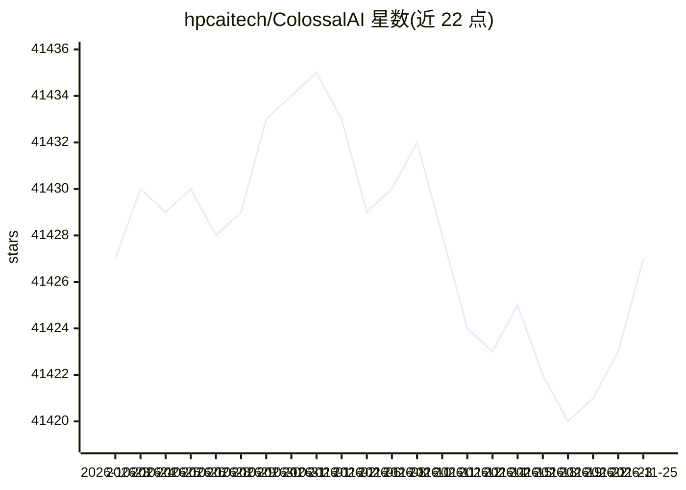

# hpcaitech/ColossalAI

⭐ 41,427 · Python · Apache-2.0 · 推送 2026-11-23 · [GitHub](https://github.com/hpcaitech/ColossalAI) · [官网](https://www.colossalai.org) · 组织维护 · 中文 README

**大模型分布式训练与推理的并行加速框架**

Colossal-AI 提供一组并行组件，覆盖数据并行、流水线并行、1D/2D/2.5D/3D 张量并行、序列并行、ZeRO 与自动并行策略，并含异构内存管理（PatrickStar）；用户以配置文件方式在数行代码内启动分布式训练与推理。README 另列出 Benchmark 数据、HPC-AI 云环境与模型 API 入口，以及 Open-Sora、Colossal-LLaMA-2、ColossalChat（RLHF 流水线）、Stable Diffusion 加速、AlphaFold 加速等应用示例。

## 筛选速览

| 维度 | 判定 | 备注 |
|---|---|---|
| AI 角色 | `ai-ecosystem` | LLM/agent 周边工具 |
| 许可风险 | `permissive` | Apache-2.0 |
| 部署形态 | `self-host` | docker 或自建部署 |
| 模型依赖 | — | README 未给出锁定关系 |
| 硬件要求 | — | 无带数字的原话,不猜 |
| 安装摩擦 | `low` | 无编译、无系统依赖或容器化 |
| 成熟度 | — | 结构信号不足 |

## 动量与使用信号

- 维护:`active` — 距上次 push 2.8 天,年发版 0,190 位贡献者
- 涨星:近 1 天 **+1**(自 20261016 起算)
- 安装:pypi 包 `colossalai` 月下载 12,511
- 平台:WINDOWS · 协议:—

## 能力要点

- 多种并行策略：数据/流水线/1D-3D 张量/序列并行/ZeRO/自动并行
- 基于配置文件启动并行训练，异构内存管理（PatrickStar）
- 附带 ColossalChat RLHF 流水线与 Colossal-Inference 推理组件
- 提供 LLaMA/GPT/BERT/PaLM/OPT/MoE 等模型的并行训练示例

## 适用场景

- 在多 GPU/集群上训练或微调大语言模型
- 以低显存配置在消费级 GPU 上做模型训练
- 为类 Sora 视频生成或蛋白质结构预测模型做并行加速

## 场景标签

`模型训练` `微调` `强化学习` `推理引擎` · 领域:训练与推理

## 证据(README 行号)

> L93: Colossal-AI provides a collection of parallel components for you. We aim to support you to write your
> L95: distributed training and inference in a few lines.
> L97: - Parallelism strategies

## 星数曲线

2026-10-23 41,427 → 2026-11-25 41,427（+0）

---
*卡片 v1 · prompt 1.4 · 生成 2026-11-22 · 置信度 high · 依据 README sha `3ded0b7a52b1` · [字段定义](../../DATASET.md)*
