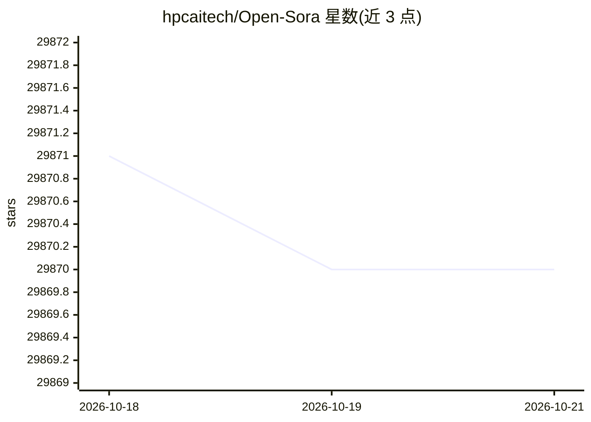

# hpcaitech/Open-Sora

⭐ 29,870 · Python · Apache-2.0 · 推送 2026-04-09 · [GitHub](https://github.com/hpcaitech/Open-Sora) · [官网](https://hpcaitech.github.io/Open-Sora/) · 组织维护

**面向开发者的开源高质量视频生成模型与训练工具集**

提供 11B 参数的视频生成模型（Open-Sora 2.0），支持文生视频与图生视频，支持 256px/768px 分辨率及多种宽高比与帧长设置，并通过 torchrun 支持单卡与多卡（ColossalAI 序列并行）推理。发布 checkpoints 与完整训练代码，含数据预处理管线；提供 arXiv 技术报告与 Hugging Face Spaces 上的 Gradio demo。安装依赖 conda 环境与 Python 3.10，可选安装 flash attention 提速。

## 筛选速览

| 维度 | 判定 | 备注 |
|---|---|---|
| AI 角色 | `ai-native` | 本体是模型或模型工具 |
| 许可风险 | `permissive` | Apache-2.0 |
| 部署形态 | `library` | 以包/库形式分发 |
| 模型依赖 | — | README 未给出锁定关系 |
| 硬件要求 | — | 无带数字的原话,不猜 |
| 安装摩擦 | `low` | 无编译、无系统依赖或容器化 |
| 成熟度 | — | 结构信号不足 |

## 动量与使用信号

- 维护:`declining` — 距上次 push 192.3 天,年发版 0,54 位贡献者
- 涨星:近 1 天 **-1**(自 20261016 起算)
- 安装:pypi 包 `modelscope` 月下载 3,602,710
- 平台:— · 协议:OPENAI-API

## 能力要点

- 11B 模型一个 checkpoint 同时支持 T2V 与 I2V，覆盖 256px 与 768px
- 发布完整训练代码与 checkpoints，报告训练成本为 $200K
- 支持多分辨率、多宽高比（16:9/9:16/1:1/2.39:1）与帧长调节
- 多 GPU 推理基于 colossalai 序列并行

## 适用场景

- 自己训练或微调视频生成模型
- 用文本或参考图生成视频
- 研究视频生成模型的训练成本优化

## 场景标签

`视频生成` `微调` · 领域:内容生成

## 证据(README 行号)

> L3: We design and implement **Open-Sora**, an initiative dedicated to **efficiently** producing high-quality video. We h
> L25: - **[2025.03.12]** 🔥 We released **Open-Sora 2.0** (11B). 🎬 11B model achieves on-par performance with 11B HunyuanV
> L131: Our 11B model supports 256px and 768px resolution. Both T2V and I2V are supported by one model. 🤗 Huggingface 🤖 Mo

## 星数曲线

2026-10-18 29,871 → 2026-10-21 29,870（-1）

---
*卡片 v1 · prompt 1.4 · 生成 2026-10-18 · 置信度 high · 依据 README sha `2f8a372ab476` · [字段定义](../../DATASET.md)*
