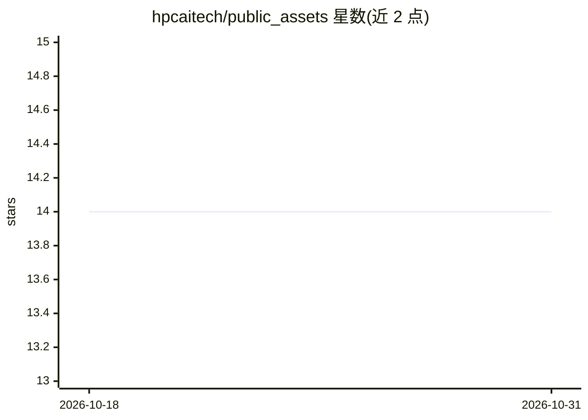

# hpcaitech/public_assets

⭐ 14 · Python · Apache-2.0 · 推送 2026-04-09 · [GitHub](https://github.com/hpcaitech/public_assets) · 组织维护

**存储公开素材（图片/动画/文本）的资产仓库**

一个用于存放公开可用资产的仓库：内容类型包括图片、动画与文本。README 仅声明此用途，未描述功能模块、安装方式或使用流程。从维护方（HPC-AI Tech）上下文看，该仓库用作项目文档与发布材料的存放处，本身不提供代码功能或 AI 能力。

## 筛选速览

| 维度 | 判定 | 备注 |
|---|---|---|
| AI 角色 | `ai-knowledge` | 知识聚合/清单类 |
| 许可风险 | `permissive` | Apache-2.0 |
| 部署形态 | `None` |  |
| 模型依赖 | — | README 未给出锁定关系 |
| 硬件要求 | — | 无带数字的原话,不猜 |
| 安装摩擦 | `low` | 无编译、无系统依赖或容器化 |
| 成熟度 | — | 结构信号不足 |

## 能力要点

- 存放图片、动画与文本等公开资产

## 适用场景

- 作为项目文档与发布素材的集中存放处

## 场景标签

 · 领域:项目资产存储

## 证据(README 行号)

> L2: Storing publicly available assets such as images, animations and texts

## 星数曲线

2026-10-18 14 → 2026-10-31 14（+0）

---
*卡片 v1 · prompt 1.4 · 生成 2026-10-31 · 置信度 low · 依据 README sha `cdcd4ee76d86` · [字段定义](../../DATASET.md)*
