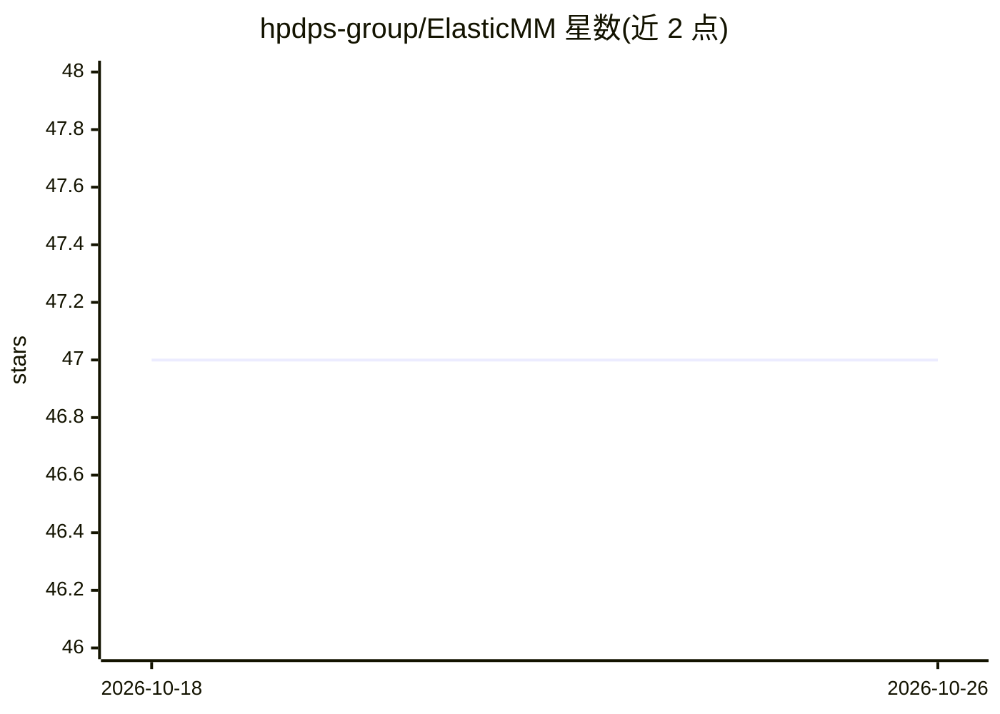

# hpdps-group/ElasticMM

⭐ 47 · Python · NOASSERTION · 推送 2026-05-10 · [GitHub](https://github.com/hpdps-group/ElasticMM) · 组织维护

**多模态大模型弹性推理服务系统，动态分配GPU资源**

面向大型多模态模型（LMM）的推理服务系统，基于 vLLM 构建（V0 后端完整支持，V1 后端 beta），提出弹性多模态并行（EMP）策略：模态级与阶段级两层调度，在纯文本与多模态负载间动态分配 GPU 实例，并支持负载均衡、实时自动扩缩与 OpenAI 兼容 API。默认配置要求至少 8 块 GPU（2 块文本 + 6 块多模态），需 Python 3.8+ 与 CUDA 11.8+，从源码安装，可选系统校准脚本对硬件做离线性能剖析。论文被 NeurIPS 2025 接收为 Oral。

## 筛选速览

| 维度 | 判定 | 备注 |
|---|---|---|
| AI 角色 | `ai-ecosystem` | LLM/agent 周边工具 |
| 许可风险 | `none` | NOASSERTION |
| 部署形态 | `None` |  |
| 模型依赖 | local-ok | 支持本地模型 |
| 硬件要求 | — | 无带数字的原话,不猜 |
| 安装摩擦 | `medium` | 含编译或系统依赖之一 |
| 成熟度 | `idea` | |

## 能力要点

- 弹性多模态并行（EMP）：文本/多模态负载间动态 GPU 分配
- 模态级+阶段级两层调度与实时自动扩缩
- OpenAI 兼容 API，支持单 GPU 到多节点部署
- 基于 vLLM 构建，支持 V0 后端并新增 V1 后端（beta）

## 适用场景

- 部署同时承载文本与多模态请求的在线推理服务
- 多 GPU 集群上按负载动态调配推理资源
- 降低多模态请求的首 token 延迟（TTFT）

## 场景标签

`推理引擎` · 领域:训练与推理

## 证据(README 行号)

> L6: ElasticMM is an efficient and scalable serving system for large multimodal models (LMMs). It introduces **Elastic Mu
> L121: - Built on top of vLLM for efficient LLM serving

## 星数曲线

2026-10-18 47 → 2026-10-26 47（+0）

---
*卡片 v1 · prompt 1.4 · 生成 2026-10-25 · 置信度 high · 依据 README sha `ec77836f8ab4` · [字段定义](../../DATASET.md)*
