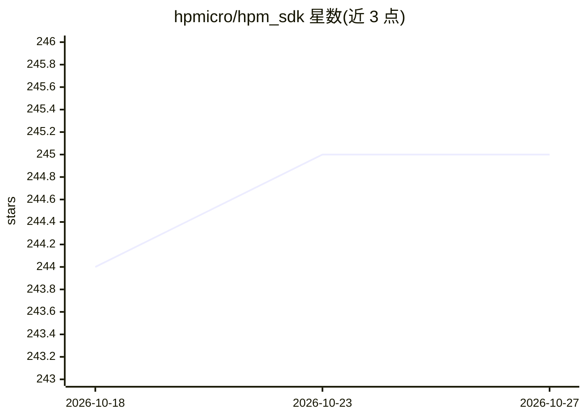

# hpmicro/hpm_sdk

⭐ 245 · C · BSD-3-Clause · 推送 2026-09-29 · [GitHub](https://github.com/hpmicro/hpm_sdk) · [官网](https://hpm-sdk.readthedocs.io/) · 组织维护 · 中文 README

**HPMicro MCU 的嵌入式软件开发套件（驱动/中间件/RTOS）**

先楫半导体为其 RISC-V MCU 系列提供的 SDK，BSD 许可，包含 CPU 架构层、板级支持文件、底层驱动、中间件（lwIP/TinyUSB 等）、组件与示例代码，并集成 FreeRTOS、Eclipse ThreadX 等 RTOS 以及 LVGL 图形库。支持多块开发板，配套 sdk_env 工具环境、修补版 OpenOCD 与 GNU 工具链仓库（镜像于 Gitee）。文档可在本地构建或通过 readthedocs 在线访问。主题标签含 machine-learning 与 gpu，但 README 正文未展开 AI 相关内容。

## 筛选速览

| 维度 | 判定 | 备注 |
|---|---|---|
| AI 角色 | `ai-enhanced` | 去掉 AI 部分产品仍成立 |
| 许可风险 | `permissive` | BSD-3-Clause |
| 部署形态 | `None` |  |
| 模型依赖 | — | README 未给出锁定关系 |
| 硬件要求 | — | 无带数字的原话,不猜 |
| 安装摩擦 | `medium` | 含编译或系统依赖之一 |
| 成熟度 | — | 结构信号不足 |

## 能力要点

- 覆盖架构层/板级/驱动/中间件/组件/示例的分层 SDK 结构
- 集成 FreeRTOS、Eclipse ThreadX、lwIP、TinyUSB、LVGL 等中间件与 RTOS
- BSD 许可，配套工具链、OpenOCD 与 sdk_env 环境仓库，Gitee 提供镜像

## 适用场景

- 开发 HPMicro MCU 嵌入式应用，直接使用驱动与板级支持
- 基于 FreeRTOS/lwIP/LVGL 构建 IoT 或 HMI 设备固件
- 查阅示例代码学习芯片外设与中间件用法

## 场景标签

 · 领域:嵌入式/物联网

## 证据(README 行号)

> L11: The HPM SDK Project is a software development kit based on HPMicro's MCUs, which supports a wide range of MCUs, bas

## 星数曲线

2026-10-18 244 → 2026-10-27 245（+1）

---
*卡片 v1 · prompt 1.4 · 生成 2026-10-22 · 置信度 low · 依据 README sha `5510d60c0c28` · [字段定义](../../DATASET.md)*
