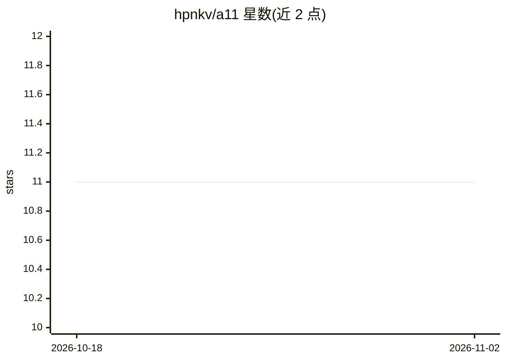

# hpnkv/a11

⭐ 11 · C++ · Apache-2.0 · 推送 2026-11-01 · [GitHub](https://github.com/hpnkv/a11) · [官网](https://a11.to) · 组织维护

**面向 AI agent 与模型应用的流式动作运行时**

开源流式动作运行时：为模型、工具与接口的连接提供命名的输出流、并发原语、工具注册（可经 MCP 暴露）、本地到远程执行，以及 Flow 运行时组合。Python API 运行在独立的 C++20 运行时之上，TypeScript/Kotlin/C++ 共享同一动作契约；模型提供方（Ollama/Claude/OpenAI 兼容）为可选 extras，按需安装。附带 Studio 用于检查 action schema、流式输出与失败信息，另有 a11 chat 命令行与托管的深度研究 agent 演示。C++ 运行时需用 CMake 自行构建，链接一组固定版本静态库。

## 筛选速览

| 维度 | 判定 | 备注 |
|---|---|---|
| AI 角色 | `ai-ecosystem` | LLM/agent 周边工具 |
| 许可风险 | `permissive` | Apache-2.0 |
| 部署形态 | `library` | 以包/库形式分发 |
| 模型依赖 | local-ok | 支持本地模型 |
| 硬件要求 | — | 无带数字的原话,不猜 |
| 安装摩擦 | `medium` | 含编译或系统依赖之一 |
| 成熟度 | — | 结构信号不足 |

## 能力要点

- 命名流输出模型文本/推理/工具活动等，本地与远程动作契约一致
- 动作注册表可经 WebSocket/HTTP SSE/WebRTC 服务，或经 MCP 暴露为工具
- 多语言（Python/TypeScript/Kotlin/C++）共享 C++20 原生运行时的动作边界
- 沙箱模式（read-only/workspace-write/unrestricted）与审批设置控制编码 agent 工具调用

## 适用场景

- 构建流式输出的 agent 应用并保持原有架构
- 将本地动作迁移到 GPU 主机或远程服务而不改输入输出契约
- 通过 Studio 检查 action 调用、日志与失败原因
- 在编码聊天中用沙箱与审批控制模型工具权限

## 场景标签

`Agent 框架` · 领域:Agent 开发

## 证据(README 行号)

> L8: A11 is the open-source runtime for connecting models, tools and interfaces
> L10: streams, concurrency, tools and local-to-remote execution, and exposes the
> L110: **Tools.** Expose registered actions to model calls through the SDK, or serve

## 星数曲线

2026-10-18 11 → 2026-11-02 11（+0）

---
*卡片 v1 · prompt 1.4 · 生成 2026-11-02 · 置信度 high · 依据 README sha `5532ef2d4a0a` · [字段定义](../../DATASET.md)*
