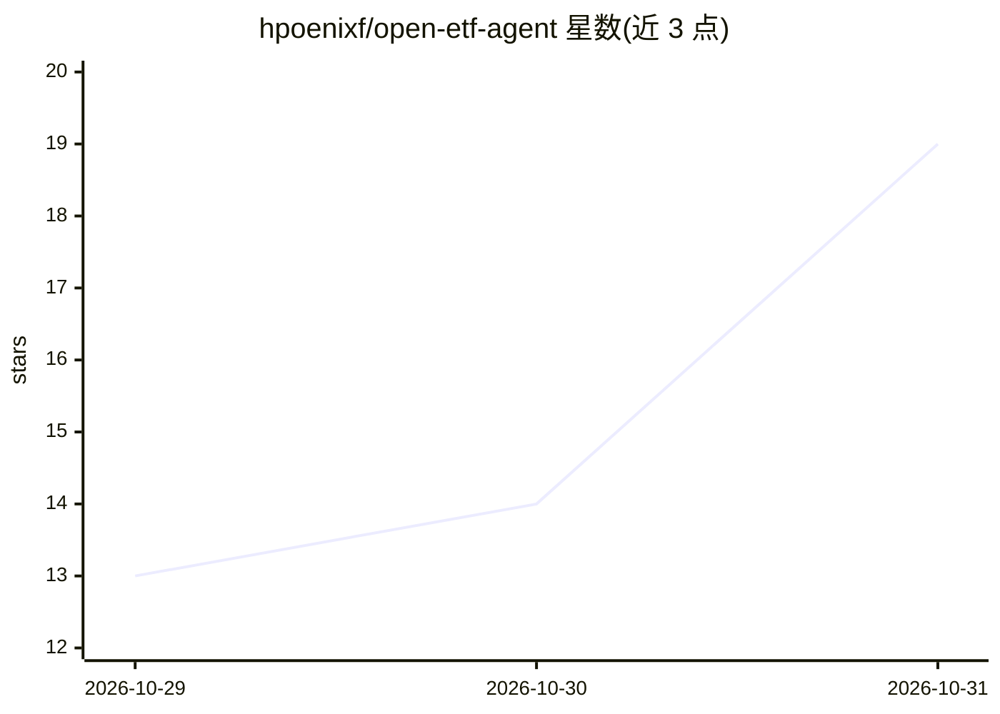

# hpoenixf/open-etf-agent

⭐ 19 · JavaScript · MIT · 推送 2026-10-30 · [GitHub](https://github.com/hpoenixf/open-etf-agent) · [官网](https://hpoenixf.com/eff-agent-article/open-etf-agent) · 个人维护 · 中文 README

**逐模块构建 ETF 投研 Agent 的教学工程：可运行代码与双语解析**

学习型 Agent 工程项目：按版本逐模块构建 ETF 投研 Agent，每个模块对应一篇架构文章与可运行的实现，覆盖串行子 Agent、只读记忆、人工交互、持久化执行与检查点等机制。默认示例离线运行、使用脚本化 Gateway fixtures 且无需模型 key，CLI 拒绝 --live；独立的 live runner 需自备 provider、数据与费用授权。明确定位为面向学习 Agent 工程的开发者，非实盘投研或交易服务，不提供投资建议。以 Node.js 源码仓库形式提供。

## 筛选速览

| 维度 | 判定 | 备注 |
|---|---|---|
| AI 角色 | `ai-ecosystem` | LLM/agent 周边工具 |
| 许可风险 | `permissive` | MIT |
| 部署形态 | `None` |  |
| 模型依赖 | — | README 未给出锁定关系 |
| 硬件要求 | — | 无带数字的原话,不猜 |
| 安装摩擦 | `low` | 无编译、无系统依赖或容器化 |
| 成熟度 | `idea` | |

## 能力要点

- 每模块 = 架构文章 + 可运行实现 + 验证证据
- 默认示例离线运行，无需模型 key（脚本化 Gateway fixtures）
- 串行专家 Child、只读记忆、人工交互、Run 持久化（report.md/manifest.json/run.jsonl）
- 明确的证据边界声明：completed 仅指执行完成，模型质量未经审核

## 适用场景

- 对照架构文章运行并验证 Agent 工程实现
- 学习持久化执行、检查点与子 Agent 委派等机制
- 追溯每个 Run 的报告与来源证据

## 场景标签

`金融量化` `教程课程` · 领域:学习与行业

## 证据(README 行号)

> L7: A learning-by-building research Agent: each module explains one engineering decision and keeps a runnable implementa
> L9: For developers learning Agent engineering, and readers who want to check an architecture article against runnable co

## 星数曲线

2026-10-29 13 → 2026-10-31 19（+6）

---
*卡片 v1 · prompt 1.4 · 生成 2026-10-30 · 置信度 high · 依据 README sha `9be617ac7d58` · [字段定义](../../DATASET.md)*
