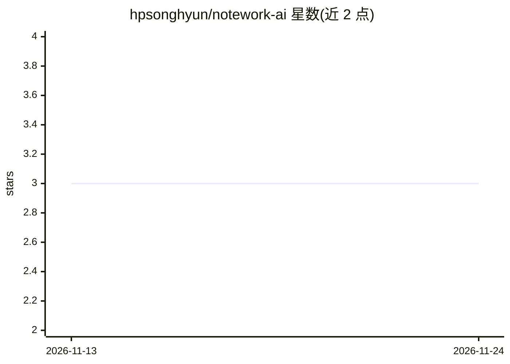

# hpsonghyun/notework-ai

⭐ 3 · JavaScript · MIT · 推送 2026-10-10 · [GitHub](https://github.com/hpsonghyun/notework-ai) · [官网](https://hpsonghyun.github.io/notework-ai/) · 个人维护

**Obsidian 插件：把本地笔记变成可提问、可溯源的知识库**

一个 Obsidian 桌面插件，对用户选定的文件夹与标签建立本地索引，支持 Ollama 本地嵌入语义检索或关键词检索，并提供本体式知识图谱（类别/角色/层级/关系）浏览与可视化。回答通过 ChatGPT（Codex）、Claude Code 或自有 API key 完成，每条回答附 Source notes 与 Retrieval details 供核对原始段落；可选 Jev 分析按主题类别、角色与候选关系组织笔记。移动端暂禁用，仅支持桌面版 Obsidian 1.11.4+，插件本体 MIT 许可。

## 筛选速览

| 维度 | 判定 | 备注 |
|---|---|---|
| AI 角色 | `ai-native` | 本体是模型或模型工具 |
| 许可风险 | `permissive` | MIT |
| 部署形态 | `None` |  |
| 模型依赖 | local-ok | 支持本地模型 |
| 硬件要求 | — | 无带数字的原话,不猜 |
| 安装摩擦 | `low` | 无编译、无系统依赖或容器化 |
| 成熟度 | `idea` | |

## 能力要点

- 本地索引 + Ollama 本地嵌入或关键词检索
- 本体式知识图谱：类别、角色、层级与关系标签
- 每条回答附可展开的来源摘录与检索路线
- 接入 ChatGPT（Codex）/Claude Code/API key/Ollama 多种连接方式

## 适用场景

- 在 Obsidian 中用自己的笔记回答问题并核对原文出处
- 为笔记集合建立可探索的主题层级知识图谱
- 敏感笔记内容保留在本地、仅发送问答所需片段

## 场景标签

`知识库管理` `知识图谱` `RAG` `文档问答` · 领域:知识与检索

## 证据(README 行号)

> L13: Notework AI brings **local knowledge**, a **knowledge graph**, and **retrieval-augmented generation (RAG)** to Obsi
> L15: Build an **ontology-style knowledge system** from your notes, ask questions, and explore **insights** with the refe

## 星数曲线

2026-11-13 3 → 2026-11-24 3（+0）

---
*卡片 v1 · prompt 1.4 · 生成 2026-11-21 · 置信度 high · 依据 README sha `3f2abb0bb496` · [字段定义](../../DATASET.md)*
