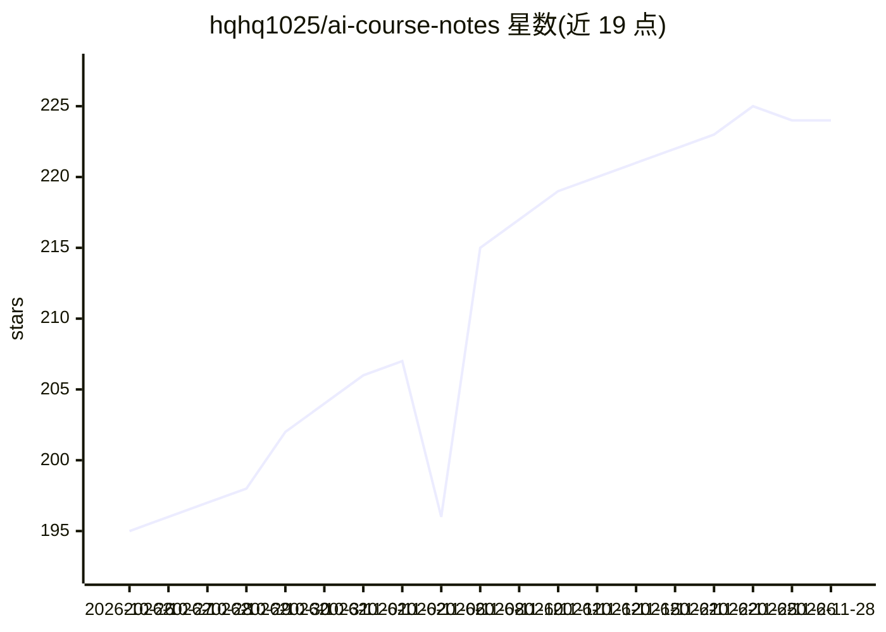

# hqhq1025/ai-course-notes

⭐ 224 · TeX · NOASSERTION · 推送 2026-10-25 · [GitHub](https://github.com/hqhq1025/ai-course-notes) · [官网](https://hqhq1025.github.io/ai-course-notes/) · 个人维护 · 中文 README

**AI/LLM 中文讲义合集：398 份 LaTeX 讲义在线阅读与编译**

将 Stanford、MIT、KAIST、Berkeley、CMU 公开课视频、访谈与技术文章整理为 398 份中文 LaTeX 讲义，LaTeX 为源文稿，网页由 `.tex` 自动生成 MkDocs 站点并部署到 GitHub Pages，支持目录导航、全文搜索、公式渲染与在线讲义的 LaTeX 源码入口。PDF 不入库，需下载源码后用 XeLaTeX 编译两遍生成。仓库历史体积较大（数 GB），README 给出浅克隆、无 blob 克隆与稀疏 checkout 等按需获取方式。讲义采用 CC BY-NC-SA 4.0 许可，仅供学习研究用途。

## 筛选速览

| 维度 | 判定 | 备注 |
|---|---|---|
| AI 角色 | `ai-knowledge` | 知识聚合/清单类 |
| 许可风险 | `none` | NOASSERTION |
| 部署形态 | `library` | 以包/库形式分发 |
| 模型依赖 | — | README 未给出锁定关系 |
| 硬件要求 | — | 无带数字的原话,不猜 |
| 安装摩擦 | `low` | 无编译、无系统依赖或容器化 |
| 成熟度 | — | 结构信号不足 |

## 能力要点

- 398 份中文讲义覆盖 8 门 Stanford 课程、Berkeley LLM Agents 系列等
- LaTeX 为源文稿，在线站点由 `.tex` 自动生成并部署 GitHub Pages
- 提供浅克隆、无 blob 克隆与稀疏 checkout 等按需获取方式
- 访谈系列 PDF 托管于 GitHub Release 提供下载

## 适用场景

- 在线阅读 Stanford CS336、CS25 等 AI 课程的中文讲义
- 按学习路线入门 LLM、RLHF 与 Agent 相关主题
- 克隆某一门课目录后本地用 XeLaTeX 编译 PDF

## 场景标签

`教程课程` · 领域:学习与行业

## 证据(README 行号)

> L3: 398 份 AI / LLM 中文讲义，支持在线阅读、LaTeX 源码查看与本地 PDF 编译
> L19: - **LaTeX 为源文稿**：仓库保留 `*-notes.tex` 和配套图片，网页由 `.tex` 自动生成；讲义 PDF 可在本地编译，不重复存入 Git。
> L86: |合计|398|统计口径：仓库内 `*-notes.tex` 讲义源文件|

## 星数曲线

2026-10-26 195 → 2026-11-28 224（+29）

---
*卡片 v1 · prompt 1.4 · 生成 2026-11-26 · 置信度 high · 依据 README sha `2ca3f1e72934` · [字段定义](../../DATASET.md)*
