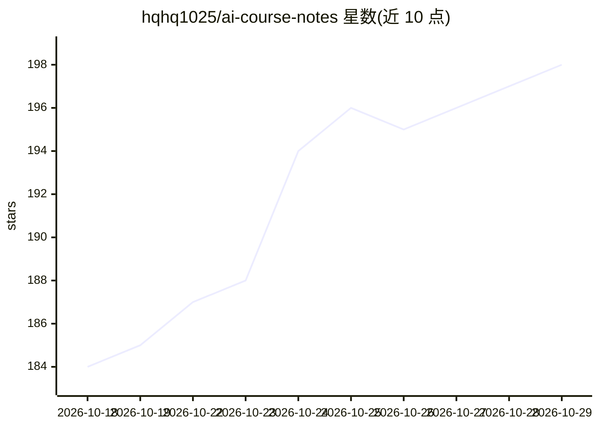

# hqhq1025/ai-course-notes

⭐ 198 · TeX · NOASSERTION · 推送 2026-10-25 · [GitHub](https://github.com/hqhq1025/ai-course-notes) · [官网](https://hqhq1025.github.io/ai-course-notes/) · 个人维护 · 中文 README

**389 份 AI/LLM 中文讲义合集，支持在线阅读与本地 PDF 编译**

将公开课视频字幕、slides、访谈与技术文章整理为 389 份中文 LaTeX 讲义，覆盖 Stanford（CS336/CS25/CS224R 等 7 门 169 份）、Berkeley LLM Agents、MIT、KAIST、CMU 课程及 B 站系列、演讲访谈与技术文章笔记。以 LaTeX 为源文稿，由 generate_site.py 自动生成 MkDocs 站点并部署到 GitHub Pages，支持目录导航与全文搜索；PDF 不入库，可 clone 后用 XeLaTeX 双遍编译生成。新讲义默认由 Argon 模型撰写、Codex 复核。完整克隆体积达数 GB，README 提供浅克隆与稀疏 checkout 方案。

## 筛选速览

| 维度 | 判定 | 备注 |
|---|---|---|
| AI 角色 | `ai-knowledge` | 知识聚合/清单类 |
| 许可风险 | `none` | NOASSERTION |
| 部署形态 | `library` | 以包/库形式分发 |
| 模型依赖 | — | README 未给出锁定关系 |
| 硬件要求 | — | 无带数字的原话,不猜 |
| 安装摩擦 | `low` | 无编译、无系统依赖或容器化 |
| 成熟度 | — | 结构信号不足 |

## 能力要点

- 389 份 `*-notes.tex` 中文讲义，覆盖 11 类来源
- LaTeX 源稿自动生成 MkDocs 在线阅读站（全文搜索、公式渲染）
- 本地 XeLaTeX 双遍编译即可生成 PDF，仓库不存 PDF
- 提供浅克隆/无 blob/稀疏 checkout 按需下载方案

## 适用场景

- 系统学习 LLM、Agent、RL 等方向的中文课程讲义
- 按推荐阅读路线入门 Transformer 与语言模型
- 只下载某一门课的讲义并本地编译 PDF

## 场景标签

`教程课程` · 领域:学习与行业

## 证据(README 行号)

> L3: 389 份 AI / LLM 中文讲义，支持在线阅读、LaTeX 源码查看与本地 PDF 编译
> L85: |合计|389|统计口径：仓库内 `*-notes.tex` 讲义源文件|

## 星数曲线

2026-10-18 184 → 2026-10-29 198（+14）

---
*卡片 v1 · prompt 1.4 · 生成 2026-10-22 · 置信度 mid · 依据 README sha `a49ca267cd05` · [字段定义](../../DATASET.md)*
