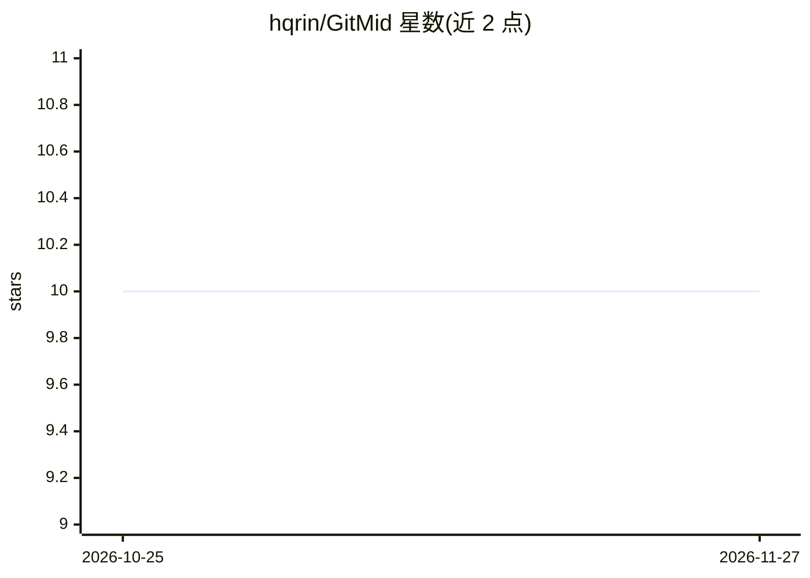

# hqrin/GitMid

⭐ 10 · TypeScript · MIT · 推送 2026-05-17 · [GitHub](https://github.com/hqrin/GitMid) · 个人维护

**给开发者的终端 AI 工具：生成 commit、changelog、解释代码**

基于 Node.js 的 CLI 工具（gitmind），提供四个命令：读取已暂存变更并按 Conventional Commits 生成提交信息、逐行解释代码文件、基于最近 15 个提交生成 Markdown 版本说明、通过 GitHub REST API 获取 PR diff 并标记潜在 bug。依赖 OpenAI API key（.env 配置），通过 npm link 全局安装后使用。需先安装 Node.js，从源码 clone 运行，无安装包。

## 筛选速览

| 维度 | 判定 | 备注 |
|---|---|---|
| AI 角色 | `ai-native` | 本体是模型或模型工具 |
| 许可风险 | `permissive` | MIT |
| 部署形态 | `None` |  |
| 模型依赖 | — | README 未给出锁定关系 |
| 硬件要求 | — | 无带数字的原话,不猜 |
| 安装摩擦 | `low` | 无编译、无系统依赖或容器化 |
| 成熟度 | — | 结构信号不足 |

## 能力要点

- gitmind commit 按暂存变更生成 Conventional Commits 消息
- gitmind explain 逐步解释指定代码文件
- gitmind pr 通过 GitHub REST API 分析 PR 并指出潜在 bug
- 声明兼容 GitHub Models，使用个人访问令牌

## 适用场景

- 提交代码时自动生成规范的 commit message
- 发布前从提交历史生成 changelog
- 快速理解陌生代码文件的作用
- 分析 Pull Request 找出潜在 bug

## 场景标签

`代码生成` `代码审查` · 领域:编码与开发

## 证据(README 行号)

> L4:  Genera commits automáticos, resume changelogs y entiende código en segundos directo desde tu terminal.
> L8: - 🤖 **`gitmind commit`**: Lee tus cambios preparados (`git add`) y redacta el mensaje de commit perfecto usando Conv
> L11: - 🐙 **`gitmind pr <numero>`**: Analiza Pull Requests usando la **API Oficial de GitHub REST** (`api.github.com`) pa
> L29: Para que GitMind cobre vida, requiere acceso a OpenAI:

## 星数曲线

2026-10-25 10 → 2026-11-27 10（+0）

---
*卡片 v1 · prompt 1.4 · 生成 2026-11-19 · 置信度 high · 依据 README sha `d48267934d5a` · [字段定义](../../DATASET.md)*
