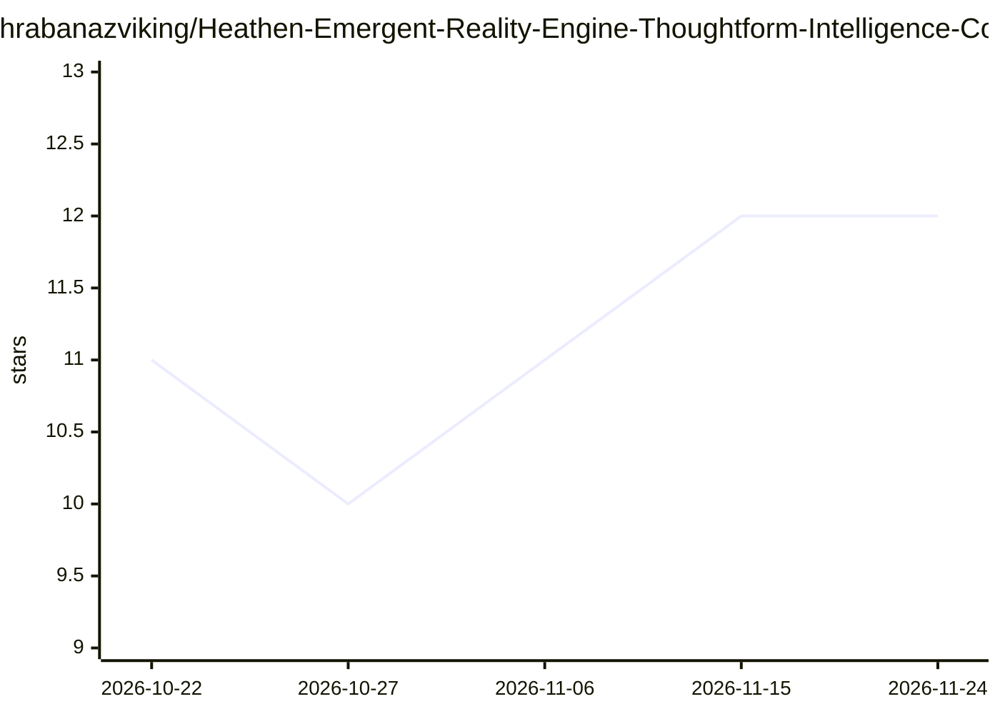

# hrabanazviking/Heathen-Emergent-Reality-Engine-Thoughtform-Intelligence-Companion

⭐ 12 · Python · MIT · 推送 2026-11-05 · [GitHub](https://github.com/hrabanazviking/Heathen-Emergent-Reality-Engine-Thoughtform-Intelligence-Companion) · 个人维护

**给任意 OpenAI 兼容 agent 提供本地感官与工具宿主运行时**

H.E.R.E.T.I.C. 定位为 AI agent 的"身体"：一个本地运行时宿主，向任何 OpenAI 兼容 agent（Claude、GPT、本地 Ollama、树莓派上的 Hermes）提供实时感官通道——语音 I/O、屏幕视觉、Blender/Photopea 创作工具、浏览器自动化、文件系统与终端，均以 MCP 工具形式暴露。架构分六层（Foundation、Bifröst 连接、Voice I/O、Vision、召唤 UI、MCP Sense Hub），另有可选离线知识子系统 Mímisbrunnr。连接按"仪式"方式开启与关闭，非常驻。原 README 中的 3D 角色生成、LangGraph 多 agent 等愿景已被 docs/BODY_MANIFESTO.md 的"body"框架取代，保留为历史记录。MIT 许可，Python 3.12+。

## 筛选速览

| 维度 | 判定 | 备注 |
|---|---|---|
| AI 角色 | `ai-ecosystem` | LLM/agent 周边工具 |
| 许可风险 | `permissive` | MIT |
| 部署形态 | `None` |  |
| 模型依赖 | local-ok | 支持本地模型 |
| 硬件要求 | — | 无带数字的原话,不猜 |
| 安装摩擦 | `low` | 无编译、无系统依赖或容器化 |
| 成熟度 | `idea` | |

## 能力要点

- 任何 OpenAI 兼容 agent 可" inhabits"的本地宿主运行时（agent-agnostic）
- 语音 I/O、屏幕视觉、浏览器/文件/终端等以 MCP 工具暴露
- 六层架构：Foundation、Bifröst 连接、Voice I/O、Vision、召唤 UI、MCP Sense Hub
- 可选离线知识子系统 Mímisbrunnr（L5.9）

## 适用场景

- 为本地运行的 agent 接入屏幕视觉、语音与终端等计算机感官
- 用 MCP 工具让已有 agent 操控 Blender、浏览器与文件系统
- 需要时可召唤、用完即关的非常驻 agent 交互环境

## 场景标签

`Agent 框架` `浏览器自动化` · 领域:Agent 开发

## 证据(README 行号)

> L20: H.E.R.E.T.I.C. is a **body for AI agents** — a local runtime host that gives any OpenAI-compatible agent realtime s
> L24: The architecture is six layers: Foundation (L0), Bifröst connection (L1), Voice I/O (L2), Vision (L3), Summoning Ci
> L26: Agent-agnostic. Hermes on Pi. Claude. GPT. Local Ollama. Any OpenAI-compatible agent can inhabit the body.

## 星数曲线

2026-10-22 11 → 2026-11-24 12（+1）

---
*卡片 v1 · prompt 1.4 · 生成 2026-11-18 · 置信度 mid · 依据 README sha `ebee6d458086` · [字段定义](../../DATASET.md)*
