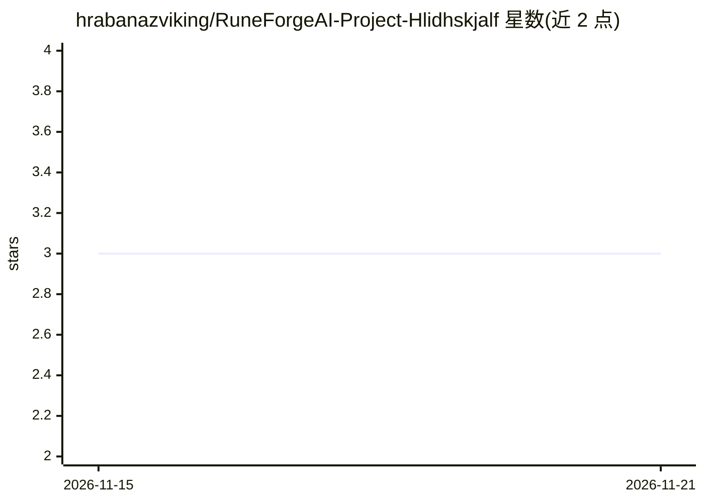

# hrabanazviking/RuneForgeAI-Project-Hlidhskjalf

⭐ 3 · Python · Apache-2.0 · 推送 2026-11-05 · [GitHub](https://github.com/hrabanazviking/RuneForgeAI-Project-Hlidhskjalf) · 个人维护

**树莓派 5 + Hailo-10 上的 Meta Muse 边缘协处理器与实时 HUD**

运行在 Raspberry Pi 5（16 GB RAM）加 Hailo-10 AI2+ HAT 上的边缘协处理器与实时 HUD，为 Meta Muse agent 主机提供本地感知与计算支持。架构分为两端：主工作站执行高参数推理与多步规划，边缘端提供 60 FPS 可视化面板（TTRPG 战斗与占星遥测）、因果世界模型 DAG、SQLite 持久存储、本地 TTS 与向量嵌入推理。通过 JSON-RPC 2.0 与 MCP 服务在 8000 端口暴露工具供 Muse 自动发现。README 给出数学公式与子系统源码节选，未提供完整安装命令。

## 筛选速览

| 维度 | 判定 | 备注 |
|---|---|---|
| AI 角色 | `ai-ecosystem` | LLM/agent 周边工具 |
| 许可风险 | `permissive` | Apache-2.0 |
| 部署形态 | `None` |  |
| 模型依赖 | — | README 未给出锁定关系 |
| 硬件要求 | — | 无带数字的原话,不猜 |
| 安装摩擦 | `low` | 无编译、无系统依赖或容器化 |
| 成熟度 | — | 结构信号不足 |

## 能力要点

- Split-Brain 异步边缘架构：工作站推理与树莓派边缘协处理分工
- MCP 服务器自动发现边缘工具，JSON-RPC 2.0 网关
- Hailo-10 NPU 本地运行 TTS（Kokoro/Piper）与嵌入模型（.hef）
- 递归子代理生成器按深度指数衰减限制进程数

## 适用场景

- 为 TTRPG 跑团提供本地仪表盘与占星/塔罗遥测显示
- 在边缘设备上为 agent 主机提供持久记忆与世界状态
- 脱离主工作站算力在本地合成语音与向量嵌入

## 场景标签

`语音合成` `Agent 记忆` · 领域:Agent 开发

## 证据(README 行号)

> L5: **Hliðskjálf-Edge-Core** is an edge co-processor and real-time HUD for Meta Muse running on a **Raspberry Pi 5 + Hai
> L455: The unified entry point on the Raspberry Pi 5. Implements JSON-RPC 2.0 and the Model Context Protocol (MCP) server

## 星数曲线

2026-11-15 3 → 2026-11-21 3（+0）

---
*卡片 v1 · prompt 1.4 · 生成 2026-11-21 · 置信度 mid · 依据 README sha `1bd2de35f246` · [字段定义](../../DATASET.md)*
