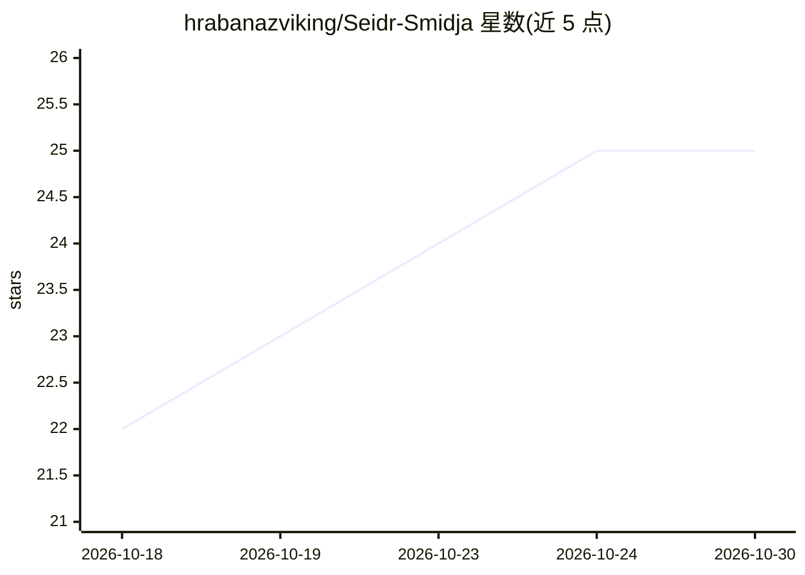

# hrabanazviking/Seidr-Smidja

⭐ 25 · Python · Apache-2.0 · 推送 2026-10-22 · [GitHub](https://github.com/hrabanazviking/Seidr-Smidja) · 个人维护

**供 AI Agent 程序化生成 VRM 虚拟形象的自动化锻造管线**

面向 Hermes、OpenClaw、Claude Code 等 AI agent 的无头 VRM 虚拟形象生成工具：agent 提交 YAML 规格描述身高、发型、服装等参数，系统加载 VRoid Studio 基础模板，以无头模式驱动 Blender 应用参数，按 VRChat/VTube Studio 规则做合规校验，渲染多视角预览图并返回 .vrm 文件与渲染图。另含 Brúarhönd 模式：经 Tailscale 远程驱动另一台机器上的 VRoid Studio 会话（截图/点击/导出）。通过 MCP、CLI、REST 与技能清单四种接口访问。无人类 GUI，需 Python 3.10+，无头路径需 Blender 与 VRM 插件；许可证 TBD，自述处于早期阶段。

## 筛选速览

| 维度 | 判定 | 备注 |
|---|---|---|
| AI 角色 | `ai-ecosystem` | LLM/agent 周边工具 |
| 许可风险 | `permissive` | Apache-2.0 |
| 部署形态 | `library` | 以包/库形式分发 |
| 模型依赖 | — | README 未给出锁定关系 |
| 硬件要求 | — | 无带数字的原话,不猜 |
| 安装摩擦 | `low` | 无编译、无系统依赖或容器化 |
| 成熟度 | `idea` | |

## 能力要点

- YAML 规格到 .vrm 的无头全流程：Blender 参数化构建+合规校验+预览渲染
- 视觉反馈回路：每次构建产出多视角 PNG 预览供 agent 审视与迭代
- Brúarhönd 模式经 Tailscale + Bearer token 远程驱动真实 VRoid Studio 会话
- 四种接口暴露同一能力：MCP、CLI、REST、Hermes/OpenClaw/Claude Code 技能清单

## 适用场景

- 让 AI agent 依据规格自动产出 VRChat/VTube Studio 可用的 VRM 形象
- agent 通过渲染预览自我评审并迭代修改虚拟形象
- 跨机器远程操控 VRoid Studio 完成仅 GUI 可达的导出与编辑操作

## 场景标签

`GUI 自动化` · 领域:效率与自动化

## 证据(README 行号)

> L16: **Seiðr-Smiðja** (Seething-Forge) is a headless, programmatic forge that lets AI agents — Hermes, OpenClaw, Claude 
> L28: Third, the forge speaks through four doors — MCP (Mjöll), CLI (Rúnstafr), REST (Straumur), and skill manifests for 

## 星数曲线

2026-10-18 22 → 2026-10-30 25（+3）

---
*卡片 v1 · prompt 1.4 · 生成 2026-10-27 · 置信度 mid · 依据 README sha `ddfb5b8e6858` · [字段定义](../../DATASET.md)*
