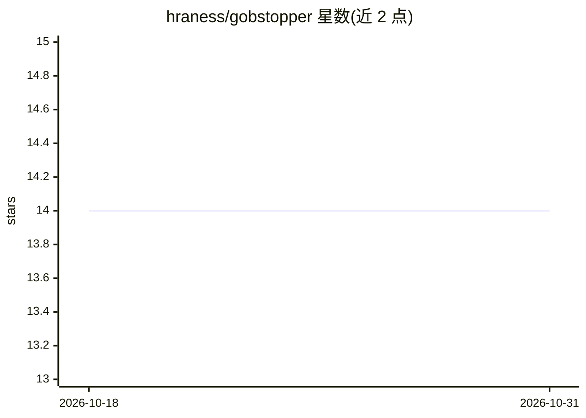

# hraness/gobstopper

⭐ 14 · Rust · Apache-2.0 · 推送 2026-10-16 · [GitHub](https://github.com/hraness/gobstopper) · [官网](https://gobstopper.sh) · 个人维护

**面向 Claude Code/Codex 的本地压缩代理：省 token 且保留完整历史**

运行在 127.0.0.1 的 API 压缩代理，替换 Claude Code 与 Codex 内置的 compaction 步骤：超过 token 阈值时保留系统提示、首个任务和最新三轮原文，旧轮次用本地规则（无模型调用）压缩为一条摘要，被摘要内容写入本地可检索的 vault。它是 CliffCompaction 论文方法的 Rust 移植，支持 Anthropic Messages、OpenAI Responses、OpenAI Chat Completions 三种方言，兼容 opencode、Crush、Aider、Goose 等客户端。也可对已保存的会话文件做压缩预览与副本准备。Terminal-Bench 2.1 自测少用 29% 输入 token。

## 筛选速览

| 维度 | 判定 | 备注 |
|---|---|---|
| AI 角色 | `ai-ecosystem` | LLM/agent 周边工具 |
| 许可风险 | `permissive` | Apache-2.0 |
| 部署形态 | `library` | 以包/库形式分发 |
| 模型依赖 | — | README 未给出锁定关系 |
| 硬件要求 | — | 无带数字的原话,不猜 |
| 安装摩擦 | `medium` | 含编译或系统依赖之一 |
| 成熟度 | — | 结构信号不足 |

## 能力要点

- 本地规则压缩，无需模型调用即可把请求压到阈值以下
- 完整历史写入本地 vault，代理可搜索与恢复
- 支持 Anthropic Messages / OpenAI Responses / OpenAI Chat Completions 三种方言
- 可复用压缩前缀以匹配 provider 提示缓存

## 适用场景

- 长会话编码 agent 降低 token 消耗
- 保留完整会话历史以便检索与恢复
- 对已保存的 Claude Code/Codex 会话文件做压缩预览

## 场景标签

`模型网关` `Agent 记忆` · 领域:Agent 开发

## 证据(README 行号)

> L21: context window. `gobstopper proxy` runs on 127.0.0.1 between your agent and
> L47: coding agents use: Anthropic Messages (Claude Code, opencode, Crush), OpenAI

## 星数曲线

2026-10-18 14 → 2026-10-31 14（+0）

---
*卡片 v1 · prompt 1.4 · 生成 2026-10-31 · 置信度 high · 依据 README sha `a8b77a71fb34` · [字段定义](../../DATASET.md)*
