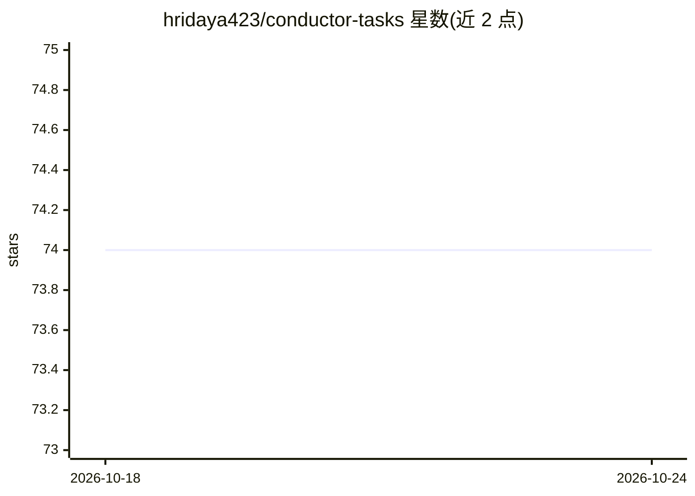

# hridaya423/conductor-tasks

⭐ 74 · TypeScript · MIT · 推送 2026-02-01 · [GitHub](https://github.com/hridaya423/conductor-tasks) · 个人维护

**面向 AI 开发的任务管理系统：MCP + CLI 解析 PRD 生成任务**

面向开发者的任务管理工具，以 MCP Server 接入编辑器或作为独立 CLI 运行。核心功能：解析 PRD/markdown/非结构化笔记生成结构化任务，自动拆分子任务并生成实施步骤，提供任务模板、研究主题（research-topic）与差异生成（generate-diff）命令，内置看板、依赖树与仪表盘可视化。支持 OpenAI、Anthropic、Groq、Mistral、Gemini、Perplexity、xAI、Azure OpenAI 等多提供商，并可配置 Ollama/LM Studio 等 OpenAI 兼容本地端点。运行需至少一个提供商 API key，npm 安装。

## 筛选速览

| 维度 | 判定 | 备注 |
|---|---|---|
| AI 角色 | `ai-ecosystem` | LLM/agent 周边工具 |
| 许可风险 | `permissive` | MIT |
| 部署形态 | `library` | 以包/库形式分发 |
| 模型依赖 | local-ok | 支持本地模型 |
| 硬件要求 | — | 无带数字的原话,不猜 |
| 安装摩擦 | `low` | 无编译、无系统依赖或容器化 |
| 成熟度 | — | 结构信号不足 |

## 能力要点

- 解析 PRD/笔记生成结构化任务并自动拆分子任务
- MCP 编辑器集成与独立 CLI 两种使用方式
- 多提供商 LLM 支持，可按任务选择模型与本地端点
- 内置看板、依赖树、仪表盘可视化

## 适用场景

- 把 PRD 文档转成可执行的开发任务清单
- 在编辑器内通过 AI 对话追踪项目任务进度
- 为每个任务按成本与需要选择不同 LLM 提供商

## 场景标签

 · 领域:开发工具/任务管理

## 证据(README 行号)

> L8: Conductor Tasks is an intelligent assistant designed for developers. It integrates seamlessly into your editor (via 
> L61: 1. **Add the MCP Server Configuration**: Add the following to your editor's MCP settings (e.g., `mcp.json`, `settin

## 星数曲线

2026-10-18 74 → 2026-10-24 74（+0）

---
*卡片 v1 · prompt 1.4 · 生成 2026-10-24 · 置信度 high · 依据 README sha `cc1099debf50` · [字段定义](../../DATASET.md)*
