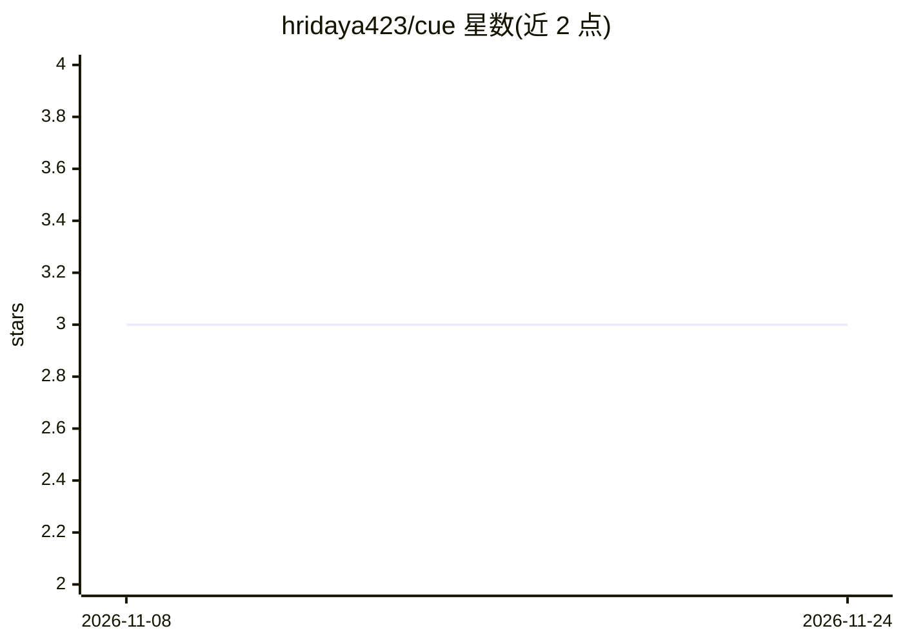

# hridaya423/cue

⭐ 3 · Swift · MIT · 推送 2026-11-07 · [GitHub](https://github.com/hridaya423/cue) · [官网](https://cue.hridya.tech) · 个人维护

**macOS 剪贴板工具：按焦点字段智能粘贴匹配的剪贴片段**

Cue 是一款 macOS 菜单栏剪贴板管理器：保留剪贴板历史（JSON 文件、可置顶、队列模式）。粘贴时通过 Accessibility API 读取焦点字段的窗口标题、角色、占位符与上下文，调用决策模型从最近 20 条剪贴与置顶项中选出匹配项，仅粘贴符合字段要求的部分；模型只做选择不生成文本，无模型或端点无响应时回退为普通 ⌘V。支持本地与远端模型、粘贴前设备端脱敏、表单连续填充，提供 DMG 安装包与源码构建路径，需 macOS 15+。

## 筛选速览

| 维度 | 判定 | 备注 |
|---|---|---|
| AI 角色 | `ai-enhanced` | 去掉 AI 部分产品仍成立 |
| 许可风险 | `permissive` | MIT |
| 部署形态 | `desktop` | 安装包/桌面程序 |
| 模型依赖 | — | README 未给出锁定关系 |
| 硬件要求 | — | 无带数字的原话,不猜 |
| 安装摩擦 | `low` | 无编译、无系统依赖或容器化 |
| 成熟度 | — | 结构信号不足 |

## 能力要点

- 读取焦点字段上下文后仅粘贴剪贴中匹配的部分，模型只选择不生成文本
- 本地模型目录自动安装权重并运行服务，含 0.8B–9B 多尺寸与轻量编码器选项
- 远端调用前用约 12 MB Core ML 模型设备端脱敏姓名、邮箱、电话、卡号
- 表单填充、队列模式、⌘V 拦截与菜单栏历史搜索

## 适用场景

- 把整段消息复制后，在邮箱字段只粘贴其中的地址
- 在网页表单中连续粘贴并自动 Tab 切换字段完成填充
- 希望剪贴板历史在本地管理且远端调用前先脱敏

## 场景标签

`AI 助手` · 领域:对话与助手

## 证据(README 行号)

> L14: Cue is a clipboard for macOS. It keeps your clipboard history. When you paste, Cue reads the focused field and asks
> L55: Some pastes need no model call. If the field asks for an email, a phone number or a URL and exactly one option matc

## 星数曲线

2026-11-08 3 → 2026-11-24 3（+0）

---
*卡片 v1 · prompt 1.4 · 生成 2026-11-21 · 置信度 high · 依据 README sha `b16427b95810` · [字段定义](../../DATASET.md)*
