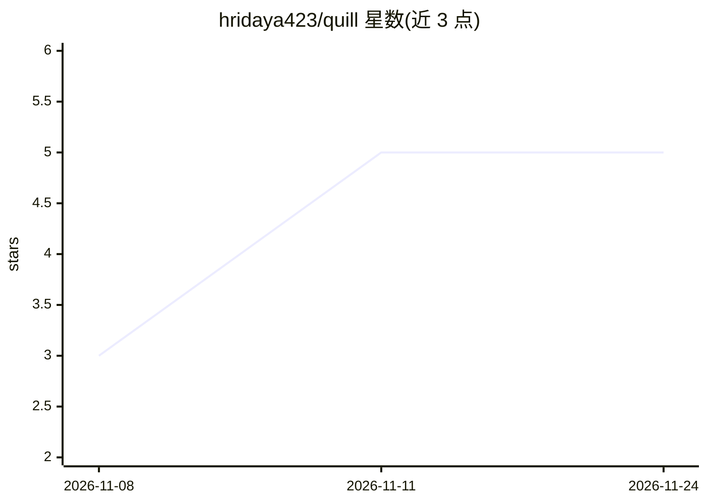

# hridaya423/quill

⭐ 5 · Swift · Apache-2.0 · 推送 2026-11-10 · [GitHub](https://github.com/hridaya423/quill) · [官网](https://quill.hridya.tech) · 个人维护

**让已付费的编码代理在 Mac Markdown 中就地改稿的编辑器**

Quill 是一款 macOS Markdown 编辑器，把 Claude Code、Codex、Cursor 等编码代理接入编辑流程：用户按住按键口述或以 ⌘K 输入请求，代理对笔记做删划线式就地修改，用户可逐条保留或回退；可向多个代理同时提问并在笔记中堆叠各作者答案。笔记保持纯 .md 文件，兼容 Obsidian 的 callout、embed、properties、数学与 Mermaid。代理复用各工具自带登录与订阅，无需 API key；Voice.md 记录用户风格规则供每次编辑前读取。需 macOS 26 及以上。

## 筛选速览

| 维度 | 判定 | 备注 |
|---|---|---|
| AI 角色 | `ai-enhanced` | 去掉 AI 部分产品仍成立 |
| 许可风险 | `permissive` | Apache-2.0 |
| 部署形态 | `desktop` | 安装包/桌面程序 |
| 模型依赖 | — | README 未给出锁定关系 |
| 硬件要求 | — | 无带数字的原话,不猜 |
| 安装摩擦 | `low` | 无编译、无系统依赖或容器化 |
| 成熟度 | — | 结构信号不足 |

## 能力要点

- 编码代理对 .md 文件就地修改，逐条 keep/revert
- 同时向多个代理提问并堆叠带署名的答案
- 复用各代理工具登录与订阅，无需 API key
- 支持 Obsidian callout/embed/properties/Mermaid 渲染

## 适用场景

- 用语音口述把含糊的邮件草稿改写得更直接
- 在 Obsidian 笔记文件夹上让代理填大纲空缺
- 同一修改请求对比多个代理的改稿结果

## 场景标签

`AI 写作` `知识库管理` · 领域:内容生成

## 证据(README 行号)

> L1: Quill: a Mac Markdown editor where AI co-writers edit your draft in place
> L15: Stop copying your draft into ChatGPT and pasting the answer back. Quill puts the coding agent you already use insid
> L23:  Works with Claude Code, Codex, Cursor, Gemini CLI, Grok Build, OpenCode, Antigravity, Devin, Pi, and fx

## 星数曲线

2026-11-08 3 → 2026-11-24 5（+2）

---
*卡片 v1 · prompt 1.4 · 生成 2026-11-21 · 置信度 mid · 依据 README sha `3d42d747e070` · [字段定义](../../DATASET.md)*
