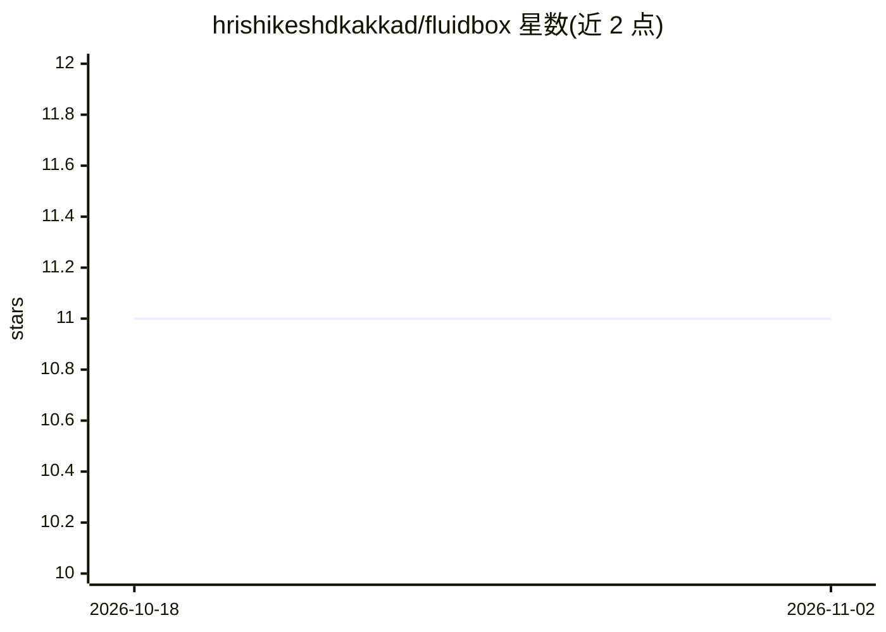

# hrishikeshdkakkad/fluidbox

⭐ 11 · Rust · MIT · 推送 2026-10-18 · [GitHub](https://github.com/hrishikeshdkakkad/fluidbox) · [官网](https://fluidbox-cloud-dashboard.vercel.app) · 个人维护

**在治理化一次性沙箱中运行 AI agent 的企业控制平面**

用 Rust 编写的控制平面，位于外部事件（PR 评论、cron、webhook、API 调用）与 AI agent 之间：注册版本化 agent 后，每次调用都成为受治理的运行——配置冻结、一次性 Docker/K8s 沙箱隔离、工具操作经服务端策略门控、审计账本记录。以统一 runner 契约运行 Claude Agent SDK 与 Codex，上游凭据不进入沙箱。面向需要在真实系统上执行 agent 并留存证据的运维/平台团队。自述 pre-1.0，预期有破坏性变更。

## 筛选速览

| 维度 | 判定 | 备注 |
|---|---|---|
| AI 角色 | `ai-ecosystem` | LLM/agent 周边工具 |
| 许可风险 | `permissive` | MIT |
| 部署形态 | `self-host` | docker 或自建部署 |
| 模型依赖 | locked-api |  |
| 硬件要求 | — | 无带数字的原话,不猜 |
| 安装摩擦 | `low` | 无编译、无系统依赖或容器化 |
| 成熟度 | `idea` | |

## 能力要点

- 不可变 RunSpec、YAML 策略与人工审批的门控运行
- 每次运行使用全新 Docker 容器或 K8s Pod，凭据留在控制平面
- Claude Agent SDK 与 Codex 两种 harness 统一 runner 契约
- GitHub App 事件、cron、webhook 等多事件源与 HMAC 回调

## 适用场景

- 让编码 agent 在受审批与预算约束的沙箱中处理 PR
- 审计 agent 运行的授权、花费与产出证据
- 在 Kubernetes 集群上部署多用户的 agent 运行基础设施

## 场景标签

`Agent 框架` · 领域:Agent 开发

## 证据(README 行号)

> L20: fluidbox sits between an external event and an AI agent. Register a versioned agent once, then borrow it from a pul
> L22: The control plane is written in Rust. It runs the Claude Agent SDK and Codex behind one runner contract, executes o

## 星数曲线

2026-10-18 11 → 2026-11-02 11（+0）

---
*卡片 v1 · prompt 1.4 · 生成 2026-11-02 · 置信度 high · 依据 README sha `011621ec8850` · [字段定义](../../DATASET.md)*
