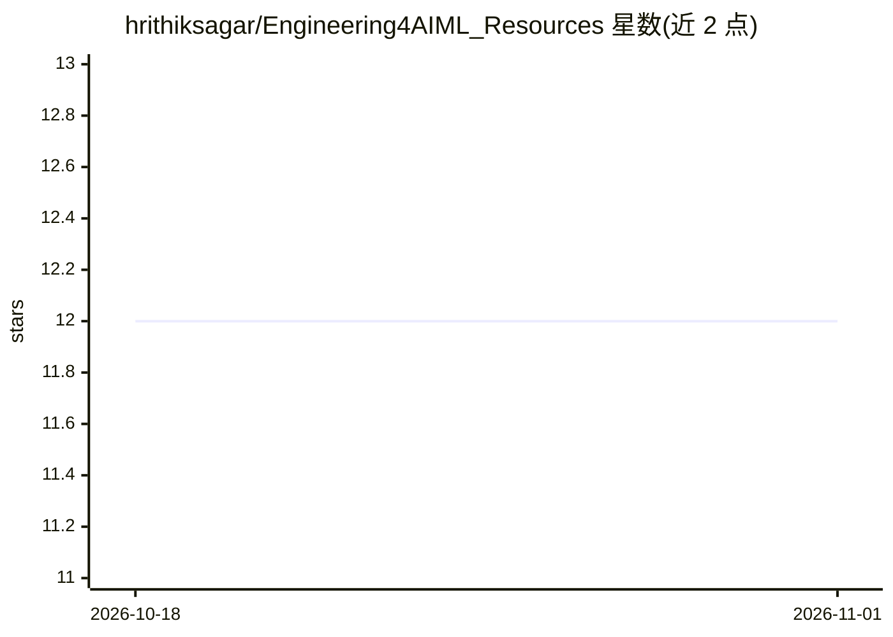

# hrithiksagar/Engineering4AIML_Resources

⭐ 12 · 推送 2026-01-23 · [GitHub](https://github.com/hrithiksagar/Engineering4AIML_Resources) · 个人维护

**机器学习学习资源合集：笔记、论文、书籍与专业建议**

个人维护的机器学习知识库仓库，按五类组织内容：PhD 导师与导师来源的专业建议（时间管理、论文写作、阅读技巧）、个人学习笔记（Transformers、DSPy、Flash Attention 等）、来自 IIIT Hyderabad 同伴的协作笔记、机器学习书籍清单以及带个人标注的研究论文合集。面向学生、研究者与从业者，通过浏览文件夹与提交 PR 方式使用与贡献，无安装或运行步骤。

## 筛选速览

| 维度 | 判定 | 备注 |
|---|---|---|
| AI 角色 | `ai-knowledge` | 知识聚合/清单类 |
| 许可风险 | `none` | — |
| 部署形态 | `None` |  |
| 模型依赖 | — | README 未给出锁定关系 |
| 硬件要求 | — | 无带数字的原话,不猜 |
| 安装摩擦 | `low` | 无编译、无系统依赖或容器化 |
| 成熟度 | — | 结构信号不足 |

## 能力要点

- 五类内容结构：专业建议、个人笔记、协作资源、书籍、研究论文
- 研究论文附带个人标注与重点标记
- 接受社区通过 PR 与 issue 贡献资源

## 适用场景

- 系统查找机器学习各主题的笔记与书籍
- 获取论文写作、时间管理与阅读方法方面的研究建议
- 浏览带标注的研究论文以辅助精读

## 场景标签

`精选清单` · 领域:学习与行业

## 证据(README 行号)

> L3: A curated collection of notes, resources, advice, and research papers to help master Machine Learning and related do
> L46: - **A learning resource**: For students, researchers, and professionals in Machine Learning.

## 星数曲线

2026-10-18 12 → 2026-11-01 12（+0）

---
*卡片 v1 · prompt 1.4 · 生成 2026-11-01 · 置信度 high · 依据 README sha `84661fd75b81` · [字段定义](../../DATASET.md)*
