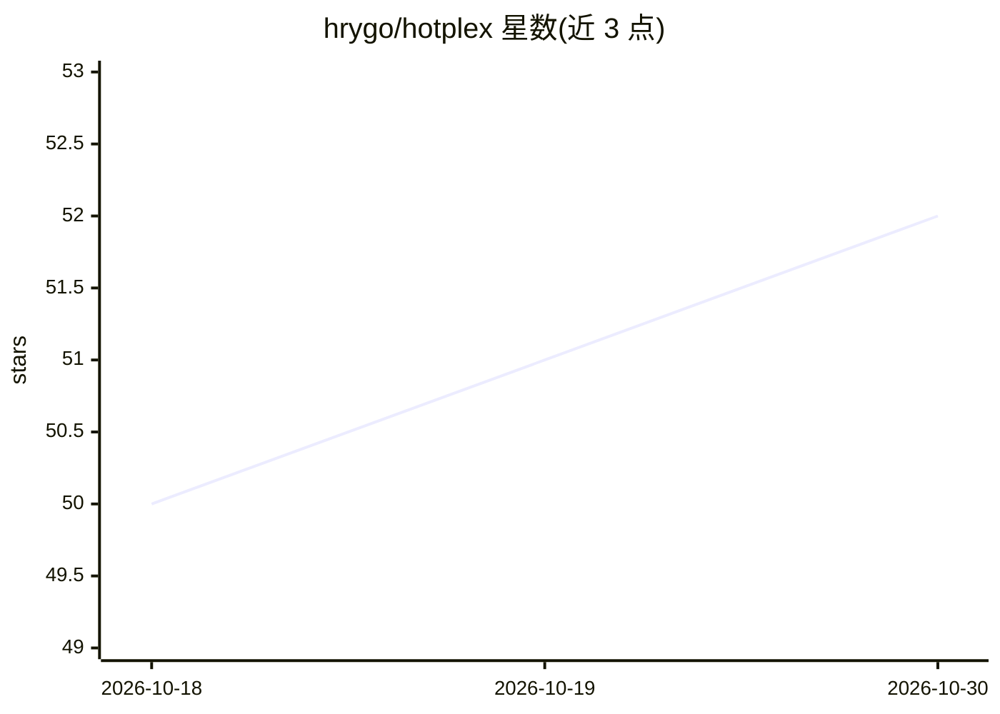

# hrygo/hotplex

⭐ 52 · Go · Apache-2.0 · 推送 2026-10-09 · [GitHub](https://github.com/hrygo/hotplex) · [官网](https://github.com/hrygo/hotplex) · 个人维护 · 中文 README

**自托管网关：把 AI 编码 agent 接入 Web、Slack、飞书等团队场景**

用 Go 编写的自托管网关，通过统一的 AEP v1 协议把 Claude Code、Codex CLI、OpenCode Server 及 ACP 兼容 agent 接入内嵌 Web Chat、Slack、飞书和 Yuanxin 等渠道，供团队以共享方式使用编码 agent。机制上由网关负责认证、会话与策略解析、生命周期持久化（SQLite 默认/PostgreSQL 共享部署）与带序号的事件流，worker 适配器转译各 agent 原生协议；支持断线后恢复会话与 mid-turn 追问。提供跨平台单二进制、四个语言的客户端 SDK、安装脚本与 Docker 等安装方式。

## 筛选速览

| 维度 | 判定 | 备注 |
|---|---|---|
| AI 角色 | `ai-ecosystem` | LLM/agent 周边工具 |
| 许可风险 | `permissive` | Apache-2.0 |
| 部署形态 | `None` |  |
| 模型依赖 | — | README 未给出锁定关系 |
| 硬件要求 | — | 无带数字的原话,不猜 |
| 安装摩擦 | `low` | 无编译、无系统依赖或容器化 |
| 成熟度 | — | 结构信号不足 |

## 能力要点

- 统一 AEP v1 接口接入 Claude Code / Codex CLI / OpenCode Server / ACP agent
- 渠道覆盖内嵌 Web Chat、Slack、飞书（含语音输入/摘要）、Yuanxin
- 确定性会话身份、持久化历史与带背压的事件流
- 单 Go 二进制含 14 个命令、27 项诊断检查，提供 Go/TS/Python/Java 四个 SDK

## 适用场景

- 在 Slack 或飞书频道里让团队共用一个编码 agent
- 从浏览器或移动端继续此前的 agent 会话
- 把自然语言请求转为定时工程任务并由指定 agent 执行
- 在企业内自建统一的多 agent 接入与审计边界

## 场景标签

`模型网关` · 领域:Agent 开发

## 证据(README 行号)

> L5:  HotPlex is a self-hosted gateway that connects AI coding agents to Web, Slack,
> L28: |**One gateway for every agent**|Connect Claude Code, Codex CLI, OpenCode Server, or any ACP-compatible agent throu
> L97: 3. **Worker adapters** translate the unified session into the native protocol of Claude Code, Codex CLI, OpenCode S

## 星数曲线

2026-10-18 50 → 2026-10-30 52（+2）

---
*卡片 v1 · prompt 1.4 · 生成 2026-10-24 · 置信度 high · 依据 README sha `1eb17030b95b` · [字段定义](../../DATASET.md)*
