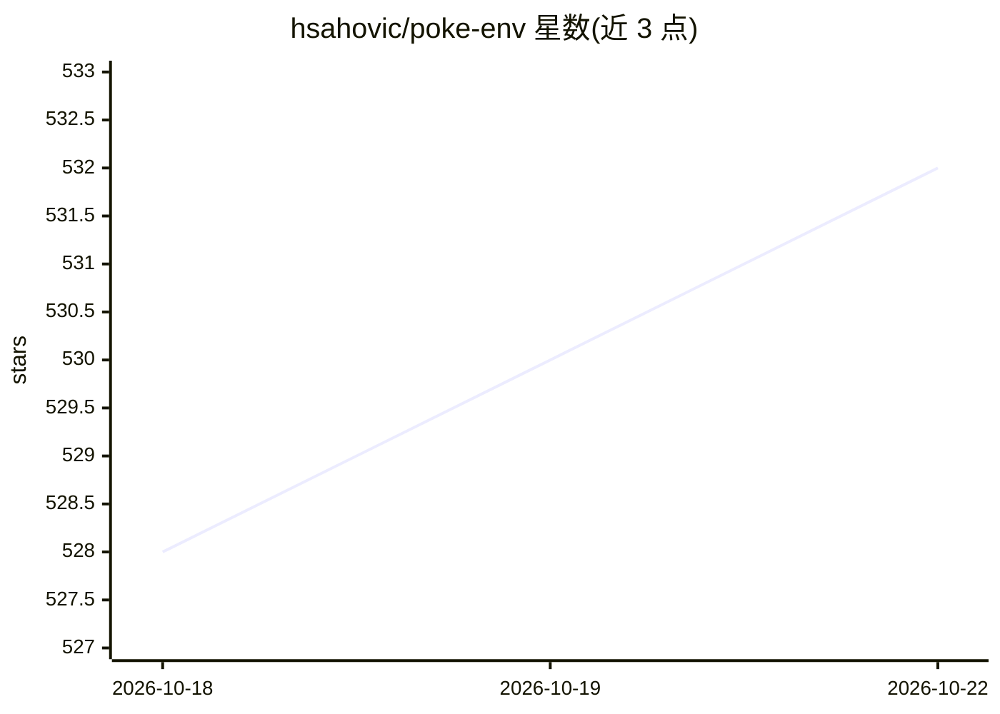

# hsahovic/poke-env

⭐ 532 · Python · MIT · 推送 2026-10-17 · [GitHub](https://github.com/hsahovic/poke-env) · [官网](https://poke-env.readthedocs.io/) · 个人维护

**给开发者的 Pokemon Showdown 对战机器人 Python 接口库**

poke-env 是一个 Python 库，用于在 Pokemon Showdown 平台上构建脚本化 agent、自博弈实验与强化学习工作流。用户通过继承 Player 类并覆写 choose_move 来编写对战机器人，内置 RandomPlayer 可用于本地验证；需连接 Pokemon Showdown 服务器，本地训练时建议自行克隆并运行 smogon/pokemon-showdown 服务器（可加 --no-security 关闭限流）。提供 pip 安装、Read the Docs 文档与示例，源自 Ecole Polytechnique 一门人工智能课程的团队项目，MIT 许可。

## 筛选速览

| 维度 | 判定 | 备注 |
|---|---|---|
| AI 角色 | `ai-ecosystem` | LLM/agent 周边工具 |
| 许可风险 | `permissive` | MIT |
| 部署形态 | `library` | 以包/库形式分发 |
| 模型依赖 | — | README 未给出锁定关系 |
| 硬件要求 | — | 无带数字的原话,不猜 |
| 安装摩擦 | `low` | 无编译、无系统依赖或容器化 |
| 成熟度 | — | 结构信号不足 |

## 能力要点

- 通过继承 Player 并覆写 choose_move 构建自定义对战机器人
- 支持脚本化 agent、自博弈实验与强化学习工作流
- 内置 RandomPlayer 用于本地对战验证
- 需配合 Pokemon Showdown 服务器使用，README 提供本地服务器搭建步骤

## 适用场景

- 用强化学习训练 Pokemon 对战机器人
- 在本地 Showdown 服务器上跑自博弈实验
- 让脚本化 agent 与真人玩家对战测试

## 场景标签

`强化学习` · 领域:训练与推理

## 证据(README 行号)

> L9: `poke-env` is a Python library for building scripted agents, self-play
> L10: experiments, and reinforcement learning workflows on

## 星数曲线

2026-10-18 528 → 2026-10-22 532（+4）

---
*卡片 v1 · prompt 1.4 · 生成 2026-10-21 · 置信度 mid · 依据 README sha `46ec8d02253d` · [字段定义](../../DATASET.md)*
