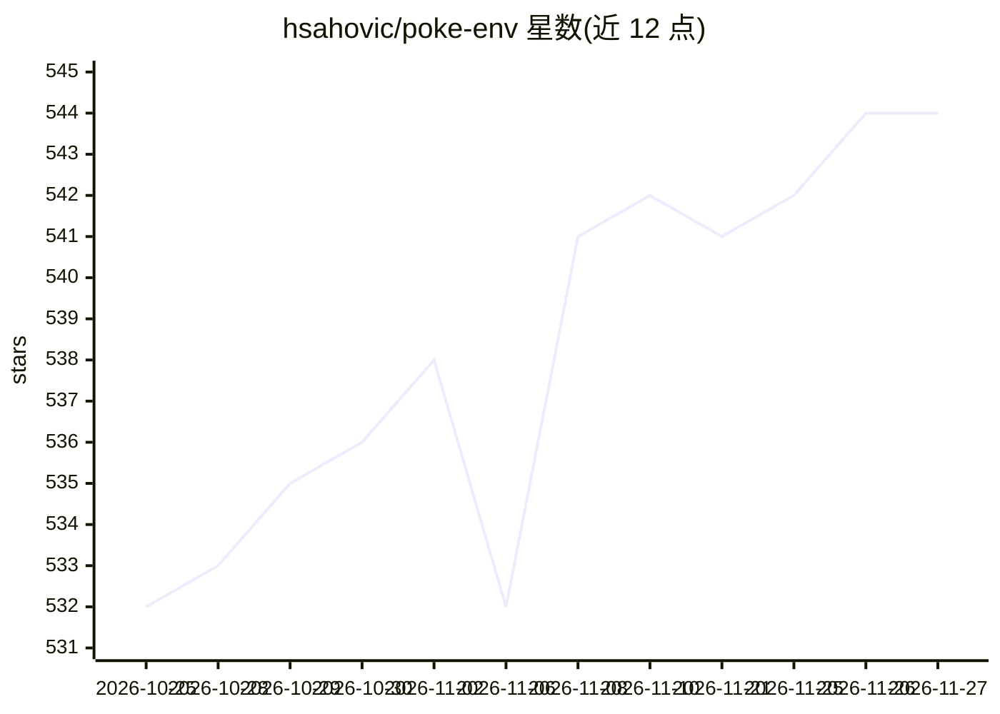

# hsahovic/poke-env

⭐ 544 · Python · MIT · 推送 2026-11-15 · [GitHub](https://github.com/hsahovic/poke-env) · [官网](https://poke-env.readthedocs.io/) · 个人维护

**构建 Pokémon Showdown 对战 bot 的 Python 接口库**

面向 Pokémon Showdown 平台的 Python 库，用于构建脚本化 bot、self-play 实验和强化学习工作流。要求 Python >= 3.10 并连接一个 Pokémon Showdown 服务器，官方推荐自建本地服务器并使用 --no-security 关闭限流。内置 RandomPlayer 等玩家类，用户可继承 Player 并覆写 choose_move 编写自己的 bot。文档与示例托管在 Read the Docs，多个基于它的对战 bot 项目（RL、LLM、MCTS 类）已被收录为案例。

## 筛选速览

| 维度 | 判定 | 备注 |
|---|---|---|
| AI 角色 | `ai-ecosystem` | LLM/agent 周边工具 |
| 许可风险 | `permissive` | MIT |
| 部署形态 | `library` | 以包/库形式分发 |
| 模型依赖 | — | README 未给出锁定关系 |
| 硬件要求 | — | 无带数字的原话,不猜 |
| 安装摩擦 | `low` | 无编译、无系统依赖或容器化 |
| 成熟度 | — | 结构信号不足 |

## 能力要点

- 提供 Player 类接口，子类化并覆写 choose_move 即可编写 bot
- 内置 RandomPlayer，可与本地服务器直接对局验证环境
- 支持 self-play 实验与强化学习工作流
- 数据文件来自 Pokémon Showdown 的 js 数据文件

## 适用场景

- 训练 Pokémon 对战的强化学习 agent
- 搭建 LLM 对战 bot 并在 Showdown 天梯上评测
- 用模拟对战做队伍构建与策略研究

## 场景标签

`强化学习` · 领域:训练与推理

## 证据(README 行号)

> L9: `poke-env` is a Python library for building scripted agents, self-play
> L10: experiments, and reinforcement learning workflows on
> L49: To build your own bot, subclass `Player` and override `choose_move`. The

## 星数曲线

2026-10-25 532 → 2026-11-27 544（+12）

---
*卡片 v1 · prompt 1.4 · 生成 2026-11-25 · 置信度 mid · 依据 README sha `796a4f626d27` · [字段定义](../../DATASET.md)*
