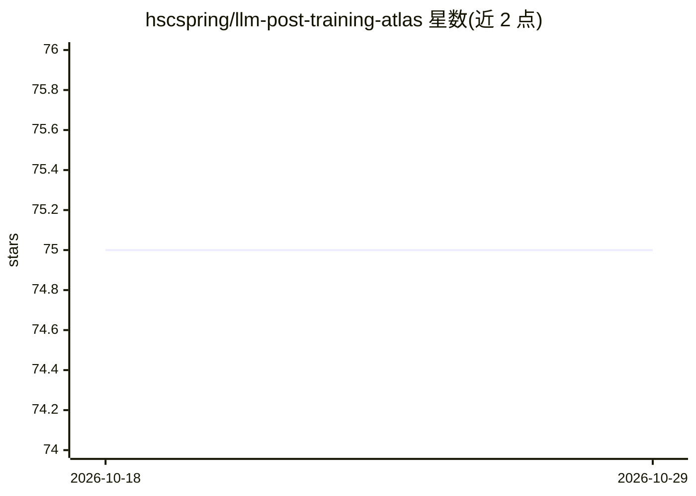

# hscspring/llm-post-training-atlas

⭐ 75 · Python · Apache-2.0 · 推送 2026-10-16 · [GitHub](https://github.com/hscspring/llm-post-training-atlas) · [官网](https://yam.gift) · 个人维护 · 中文 README

**R1 之后 LLM 后训练论文的策展图谱：7 条主线加作者裁决**

由个人作者维护的 post-R1 LLM 后训练论文策展仓库：逐篇阅读、分类并交叉链接工作，覆盖 RL/RLVR、GRPO 系策略优化、奖励建模与验证器、MoE 稳定性、Training-Free RL、SFT×RL 统一理论与 Agentic RL 七条主线；每条主线给出作者自述的结论性判断而非论文摘要，并建立跨论文关联（如 RLOO≡GRPO、OPD 作为蒸馏-RL 桥）。多数条目回链到作者在 yam.gift 的中文深度文章。收录范围明确排除纯预训练，持续更新中。

## 筛选速览

| 维度 | 判定 | 备注 |
|---|---|---|
| AI 角色 | `ai-knowledge` | 知识聚合/清单类 |
| 许可风险 | `permissive` | Apache-2.0 |
| 部署形态 | `None` |  |
| 模型依赖 | — | README 未给出锁定关系 |
| 硬件要求 | — | 无带数字的原话,不猜 |
| 安装摩擦 | `low` | 无编译、无系统依赖或容器化 |
| 成熟度 | — | 结构信号不足 |

## 能力要点

- 7 条主线的作者结论性判断，非论文摘要罗列
- 跨论文机制关联（RLOO≡GRPO、蒸馏-RL 桥、分布对齐透镜）
- 时间线博客按一年半编辑脉络组织（R1→GRPO→Reward→MoE→Training-Free→policy diff）
- Pre-R1 历史锚点单列并附作者个人理由

## 适用场景

- 系统梳理 R1 之后后训练领域的方法脉络
- 按主线查找 RL、奖励建模、Agentic RL 等方向的论文与中文解读
- 获取作者对各技术路线的交叉关联与结论性判断

## 场景标签

`精选清单` · 领域:学习与行业

## 证据(README 行号)

> L3: > **An opinionated map of post-R1 LLM post-training — RL, reward, alignment, distillation, agents, and the connectio
> L24: - **Has a verdict, not a vote.** Each of the 7 tracks ends with the author's bottom-line judgment ("data sets the c
> L33: Blog posts on yam.gift are grouped into 7 tracks. Each verdict below is the author's own bottom-line judgment, not 

## 星数曲线

2026-10-18 75 → 2026-10-29 75（+0）

---
*卡片 v1 · prompt 1.4 · 生成 2026-10-24 · 置信度 high · 依据 README sha `4397e21f5ed4` · [字段定义](../../DATASET.md)*
