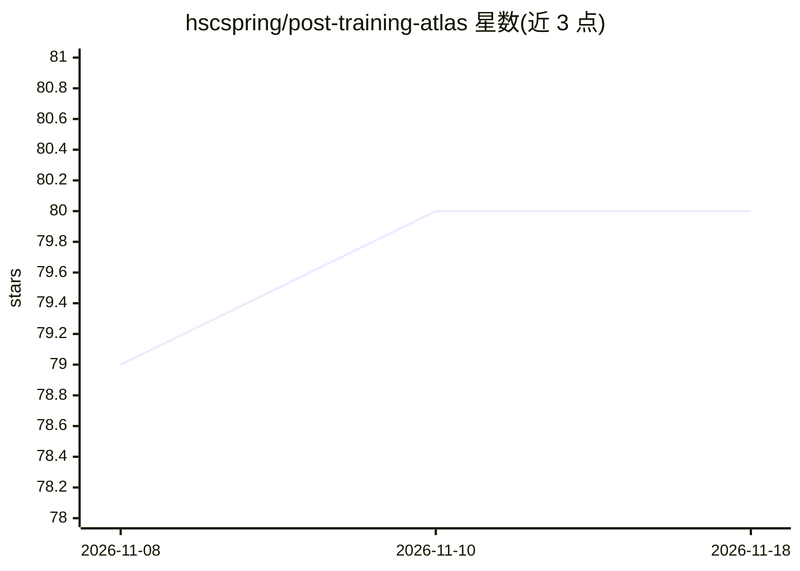

# hscspring/post-training-atlas

⭐ 80 · Python · Apache-2.0 · 推送 2026-11-03 · [GitHub](https://github.com/hscspring/post-training-atlas) · [官网](https://yam.gift) · 个人维护 · 中文 README

**模型后训练论文策展图谱：7 条主线串联 RL/奖励/蒸馏等方法**

由个人作者维护的后训练论文策展仓库：将 RL/RLVR、奖励建模与验证器、GRPO 变体、MoE RL 稳定性、范式前沿、后训练统一理论等论文按共享机制（而非模态）组织为 7 条主线，每条主线末给出作者自述的结论性判断；条目间做交叉链接（如 RLOO ≡ GRPO 的推导），多数工作回链到作者的中文深度解析文章，并附按发表顺序的时间线。仓库声明持续更新，收录有明确的纳入/排除政策（纯预训练排除）。

## 筛选速览

| 维度 | 判定 | 备注 |
|---|---|---|
| AI 角色 | `ai-knowledge` | 知识聚合/清单类 |
| 许可风险 | `permissive` | Apache-2.0 |
| 部署形态 | `None` |  |
| 模型依赖 | — | README 未给出锁定关系 |
| 硬件要求 | — | 无带数字的原话,不猜 |
| 安装摩擦 | `low` | 无编译、无系统依赖或容器化 |
| 成熟度 | — | 结构信号不足 |

## 能力要点

- 7 条机制主线组织后训练论文，模态仅作元数据
- 每条主线附作者的结论性判断而非论文摘要
- 论文间交叉链接（如 RLOO ≡ GRPO、REINFORCE+IS → CISPO）
- 明确的收录政策：纯预训练与普通微调排除在外

## 适用场景

- 系统梳理后训练各机制分支的论文脉络
- 通过作者结论快速把握某条主线的核心争议
- 按时间线追踪 R1 之后后训练思想的演化顺序

## 场景标签

`精选清单` · 领域:学习与行业

## 证据(README 行号)

> L3: > **An opinionated map of model post-training — the signals, objectives, estimators, feedback loops, and connections
> L42: Awesome lists are *retrievers*. This repo is a *curator*.
> L53: Blog posts on yam.gift are grouped into 7 tracks. Each verdict below is the author's own bottom-line judgment, not 

## 星数曲线

2026-11-08 79 → 2026-11-18 80（+1）

---
*卡片 v1 · prompt 1.4 · 生成 2026-11-18 · 置信度 high · 依据 README sha `aaa63618c882` · [字段定义](../../DATASET.md)*
