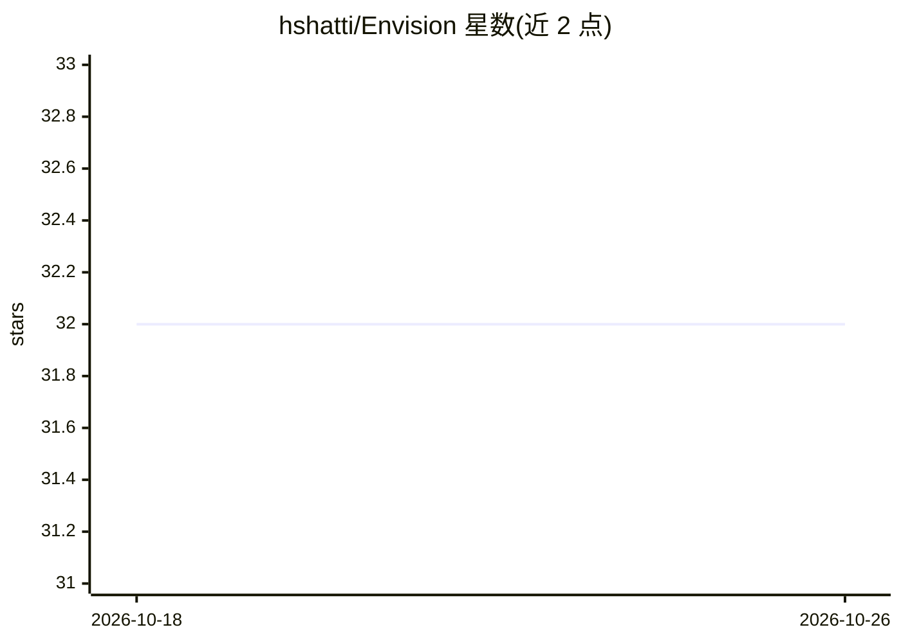

# hshatti/Envision

⭐ 32 · Pascal · MIT · 推送 2026-10-07 · [GitHub](https://github.com/hshatti/Envision) · 个人维护

**纯 Pascal 编写的 FLUX2/ZImage 文生图推理引擎，供 Delphi/FPC/Lazarus 使用**

以纯 Pascal 实现的 FLUX2（Klein 4B/9B、Klein-base）与 ZImage-Turbo 图像生成推理引擎，原生解析 Safetensors 与 JSON 权重，无外部依赖即可运行。通过懒加载与 mmap 降低内存占用，含手写 x86_64 汇编优化 CPU 性能；Windows/Linux 可自动绑定 OpenBLAS 提速，macOS 使用系统 Accelerate 框架。支持文生图与 FLUX2 参考图引导的图生图。需 Lazarus+FPC 3.2+ 或 Delphi 12 CE+ 编译构建，通过示例工程运行。Vulkan/CUDA/LoRA 等为进行中功能。

## 筛选速览

| 维度 | 判定 | 备注 |
|---|---|---|
| AI 角色 | `ai-native` | 本体是模型或模型工具 |
| 许可风险 | `permissive` | MIT |
| 部署形态 | `None` |  |
| 模型依赖 | — | README 未给出锁定关系 |
| 硬件要求 | — | 无带数字的原话,不猜 |
| 安装摩擦 | `medium` | 含编译或系统依赖之一 |
| 成熟度 | `idea` | |

## 能力要点

- 纯 Pascal 实现 FLUX2 与 ZImage 推理，零外部依赖
- mmap 懒加载降低内存占用，手写 x86_64 汇编优化
- 可选 OpenBLAS 加速（Win/Linux），macOS 自动用 Accelerate 框架
- FLUX2 支持参考图到图、多参考图到图的图像编辑

## 适用场景

- 在 Delphi/FPC/Lazarus IDE 中本地运行 FLUX2 文生图
- 基于参考图做图生图编辑（如风格化、内容改写）
- 打包小于 4MB 的独立可执行文件交付图像生成功能

## 场景标签

`图像生成` `推理引擎` · 领域:内容生成

## 证据(README 行号)

> L2:  A Lightweight FLUX2 or ZImage Inference engine Written in Pure Pascal for (FPC, Lazarus or Delphi)
> L5: > - Natively parses .Safetensors and .JSON files.
> L53: ## Showcase

## 星数曲线

2026-10-18 32 → 2026-10-26 32（+0）

---
*卡片 v1 · prompt 1.4 · 生成 2026-10-26 · 置信度 high · 依据 README sha `6f294a4cf17b` · [字段定义](../../DATASET.md)*
