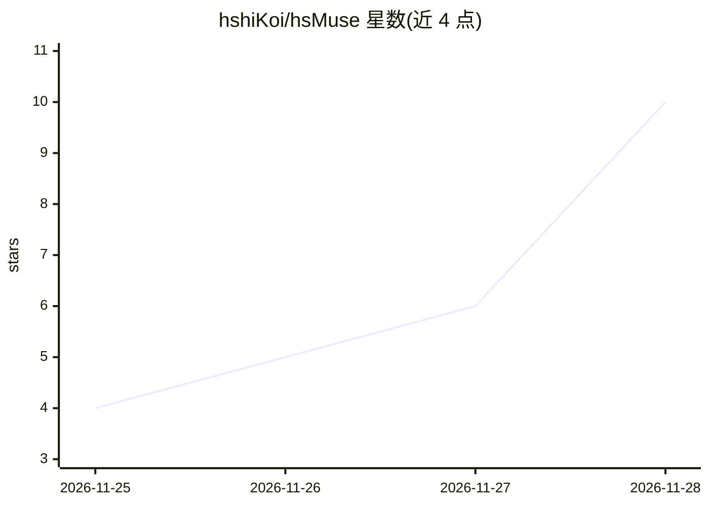

# hshiKoi/hsMuse

⭐ 10 · 推送 2026-11-27 · [GitHub](https://github.com/hshiKoi/hsMuse) · [官网](https://www.patreon.com/c/hshiKoi) · 个人维护 · 中文 README

**零显存本地 AI 绘画提示词生成与 Tag 清洗工作台**

纯本地运行、零显存占用的提示词引擎与资产管理工具，适配 ComfyUI / Flux / Krea 2 / SDXL。一键同步输出 8 级规范排序 Tag 序列与自然语言长句，内置四大世界观隔离、室内外空间锁、16 套电影机位与防重复队列；支持最高 500 位角色库（含 LoRA 触发词）、40 套 JSON 词库扩展、最高 200 行批量清洗（剥离 LoRA/权重/废词）。桌面端为 Windows 安装包，另提供本地 WebUI 双端实时同步。

## 筛选速览

| 维度 | 判定 | 备注 |
|---|---|---|
| AI 角色 | `ai-native` | 本体是模型或模型工具 |
| 许可风险 | `none` | — |
| 部署形态 | `desktop` | 安装包/桌面程序 |
| 模型依赖 | — | README 未给出锁定关系 |
| 硬件要求 | — | 无带数字的原话,不猜 |
| 安装摩擦 | `low` | 无编译、无系统依赖或容器化 |
| 成熟度 | — | 结构信号不足 |

## 能力要点

- 零显存本地运行，一键输出 8 级排序 Tag 序列与自然语言长句
- 最高 200 行批量清洗：按需剥离 LoRA、权重、废词、外貌或基础服装
- 500 位角色库与 40 套模块化 JSON 词库，支持 AI 造库导入与联网去重收录
- 桌面端 + 本地 WebUI 实时同步，四引擎并发翻译与 Gist 增量云同步

## 适用场景

- 为 ComfyUI / SDXL 等绘画流程快速组装规范 Tag 提示词
- 批量清洗从 Danbooru 等来源抓取的 tag 序列
- 管理多世界观角色与 LoRA 触发词避免串戏
- 离线环境下维护个人提示词资产库

## 场景标签

`提示工程` `图像生成` · 领域:Agent 开发

## 证据(README 行号)

> L23: **hsMuse** 是一款纯本地运行、零显存占用的 AI 绘画提示词引擎与资产管理工作台，深度适配 **ComfyUI / Flux / Krea 2 / SDXL**。一键同步输出 **「8 级规范排序 Tag 序列」** 与
> L47: - **多源并发灵感直采 & 批量清洗转换**：支持 SFW / 纯欲 / R18 分级并发抓取并沉淀至本地池；支持单次最高 200 行批量清洗，按需剥离 LoRA、权重、废词、外貌或基础服装（保留景别与神态词），一键转安全预览 

## 星数曲线

2026-11-25 4 → 2026-11-28 10（+6）

---
*卡片 v1 · prompt 1.4 · 生成 2026-11-24 · 置信度 high · 依据 README sha `7a567881df45` · [字段定义](../../DATASET.md)*
