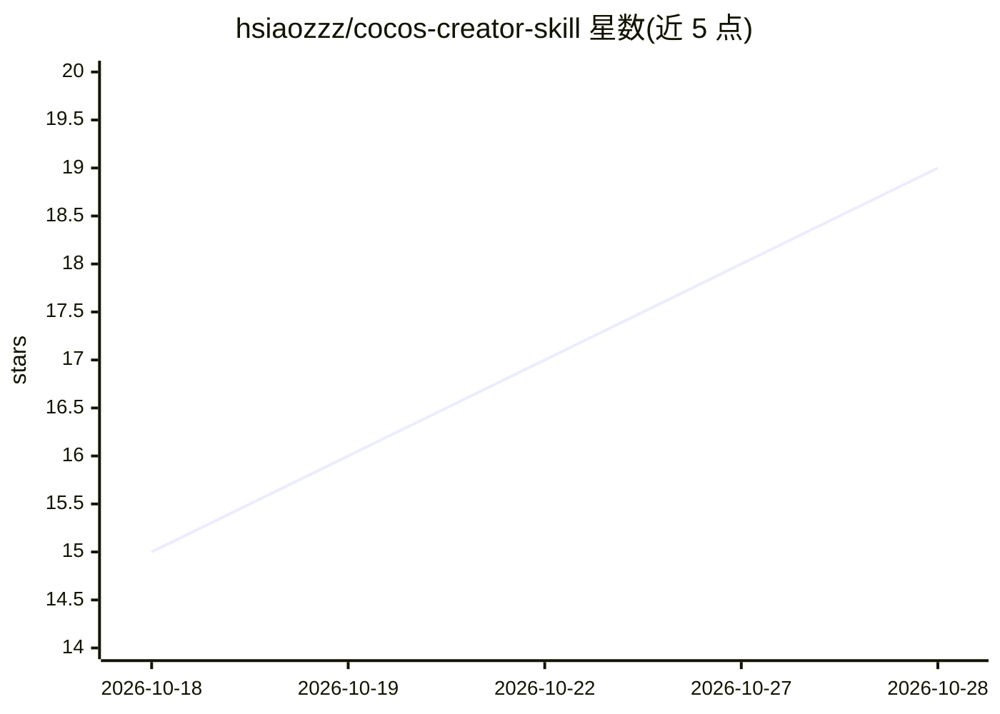

# hsiaozzz/cocos-creator-skill

⭐ 20 · JavaScript · MIT · 推送 2026-09-11 · [GitHub](https://github.com/hsiaozzz/cocos-creator-skill) · 个人维护 · 中文 README

**给 AI 编程 Agent 注入 Cocos Creator 游戏开发专长的技能包**

遵循 Agent Skills 开放标准的技能包：以 SKILL.md 加参考文件与模板的形式，向 Claude Code、Codex CLI、DeepSeek Harness、WorkBuddy、Cursor 等 100+ AI 编程平台注入 Cocos Creator 3.8.x / COCOS 4 游戏开发工作流（确认引擎版本→定位代码→编写→强制验证→交付前自查），并附反合理化规则与红旗清单。技能本体为纯 Markdown，无运行时依赖；提供官方 skills CLI、内置 install.mjs 与手动复制三种安装方式，另含可选的 Python 项目健康检查脚本。

## 筛选速览

| 维度 | 判定 | 备注 |
|---|---|---|
| AI 角色 | `ai-ecosystem` | LLM/agent 周边工具 |
| 许可风险 | `permissive` | MIT |
| 部署形态 | `library` | 以包/库形式分发 |
| 模型依赖 | — | README 未给出锁定关系 |
| 硬件要求 | — | 无带数字的原话,不猜 |
| 安装摩擦 | `low` | 无编译、无系统依赖或容器化 |
| 成熟度 | — | 结构信号不足 |

## 能力要点

- 同一份 SKILL.md 未修改即可用于 100+ AI 编程平台
- 工作流含强制验证步骤与反合理化规则、红旗清单
- 三种安装途径：npx skills CLI / 内置 install.mjs / 手动复制
- 可选 cocos_doctor.py 项目健康检查脚本

## 适用场景

- 让 Claude Code / Codex 等 Agent 按 Cocos Creator 规范编写并验证游戏代码
- 团队将技能提交到项目仓库，统一 Agent 生成代码的引擎约定
- 离线或受限网络环境下通过本地安装器部署技能

## 场景标签

`编码 Agent` `提示工程` · 领域:Agent 开发

## 证据(README 行号)

> L9: **Cocos Creator 3.8.x / COCOS 4 game-development skill for AI coding agents**
> L15: A skill package following the Agent Skills open standard that injects Cocos Creator game-development expertise into
> L19: The same unmodified `SKILL.md` works on Claude Code, Codex CLI, DeepSeek Harness (dsh), WorkBuddy, Cursor, GitHub C

## 星数曲线

2026-10-18 15 → 2026-10-28 19（+4）

---
*卡片 v1 · prompt 1.4 · 生成 2026-10-28 · 置信度 high · 依据 README sha `8e0709e9a065` · [字段定义](../../DATASET.md)*
