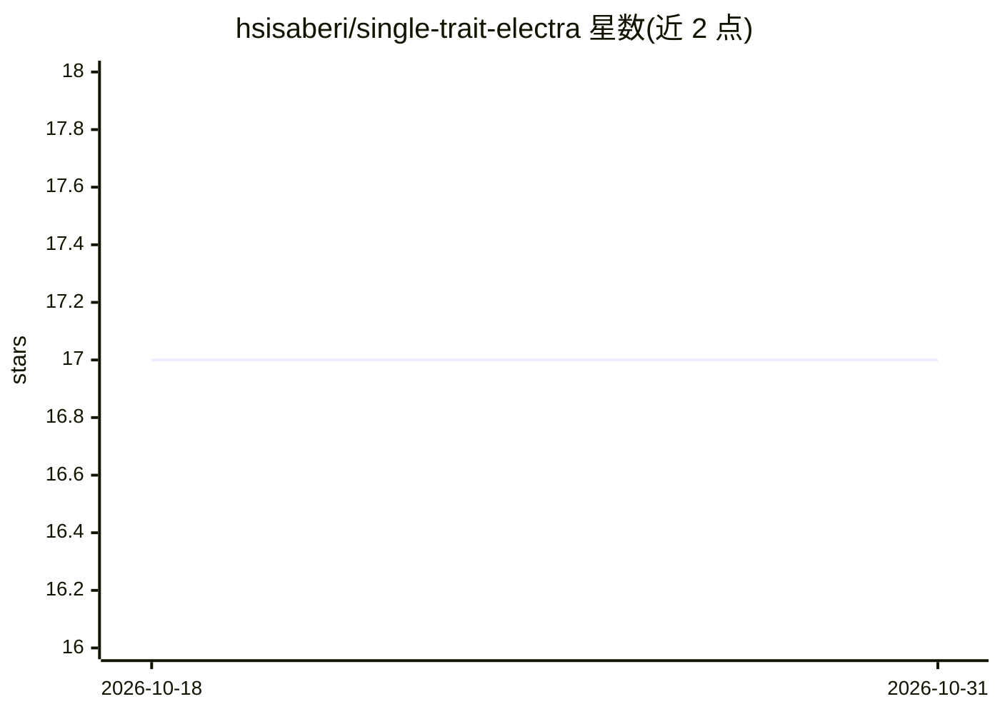

# hsisaberi/single-trait-electra

⭐ 17 · Python · MIT · 推送 2026-04-23 · [GitHub](https://github.com/hsisaberi/single-trait-electra) · 个人维护

**基于 ELECTRA 的大五人格特质识别研究框架（论文复现）**

实现论文《Transformer-Based Personality Trait Recognition Enhanced by Contextual Augmentation》完整实验流程的代码库：对大五人格的每个特质分别训练独立的 ELECTRA 二分类器，覆盖数据划分、k 折交叉验证、网格搜索超参优化、评估与新文本推理。数据增强包含 WordNet 同义替换与 gemma-27b-it 上下文增强两种方式，Pennebaker & King 数据集由 2,467 篇短文扩充至 4,934 篇。面向科研复现与心理学文本分析开发者，通过 Conda 环境与 requirements.txt 安装。

## 筛选速览

| 维度 | 判定 | 备注 |
|---|---|---|
| AI 角色 | `ai-native` | 本体是模型或模型工具 |
| 许可风险 | `permissive` | MIT |
| 部署形态 | `library` | 以包/库形式分发 |
| 模型依赖 | — | README 未给出锁定关系 |
| 硬件要求 | — | 无带数字的原话,不猜 |
| 安装摩擦 | `low` | 无编译、无系统依赖或容器化 |
| 成熟度 | — | 结构信号不足 |

## 能力要点

- 单一特质独立建模：五个 ELECTRA 分类器分别对应一个人格特质
- 数据增强两条路径：WordNet 同义替换与 gemma-27b-it 上下文增强
- k 折交叉验证与网格搜索超参优化脚本
- 对新文本推理，输出特质高/低标签

## 适用场景

- 复现论文实验并重现训练/评估曲线
- 在自有文本上训练大五人格特质分类器
- 构建人格识别研究流水线（划分/增强/训练/评估/推理）

## 场景标签

`科研工具` · 领域:学习与行业

## 证据(README 行号)

> L10: The project provides a complete pipeline for **data preprocessing**, **augmentation**, **model training**, **k-fold
> L115: python infer.py

## 星数曲线

2026-10-18 17 → 2026-10-31 17（+0）

---
*卡片 v1 · prompt 1.4 · 生成 2026-10-29 · 置信度 high · 依据 README sha `8b47d690baa4` · [字段定义](../../DATASET.md)*
