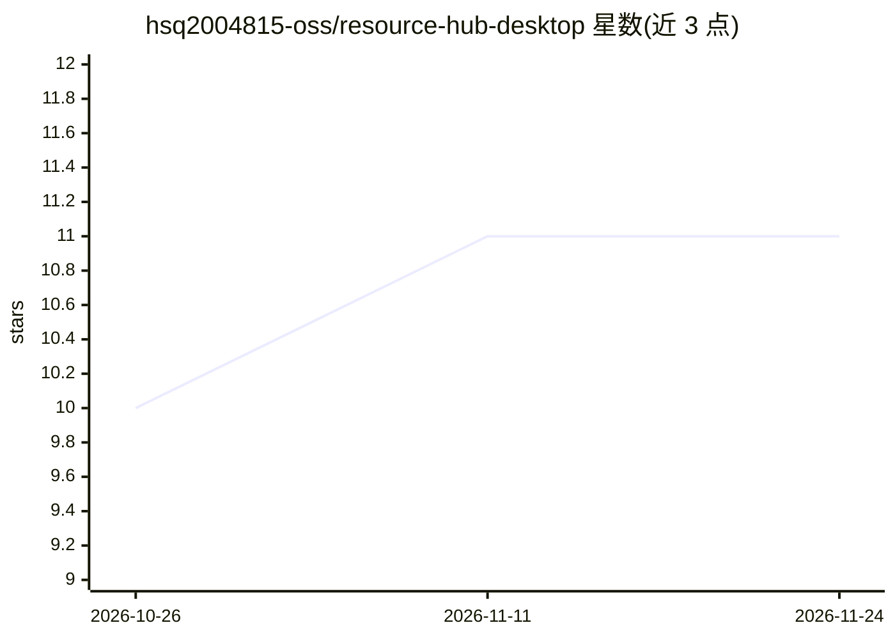

# hsq2004815-oss/resource-hub-desktop

⭐ 11 · Python · MIT · 推送 2026-11-01 · [GitHub](https://github.com/hsq2004815-oss/resource-hub-desktop) · [官网](https://github.com/hsq2004815-oss/resource-hub-desktop/releases/latest) · 个人维护 · 中文 README

**Windows 快捷启动器：一键呼出面板管理网站、文件夹收藏**

Flutter + Python 后端的 Windows 快捷启动器，把浏览器收藏、文件夹、文件汇入一个可搜索列表；Alt+Space 或鼠标侧键呼出紧凑快捷面板，文件夹内容以思维导图展开浏览。支持 Chrome/Edge 书签只读同步、按站点选择浏览器、JSON 导入导出备份。可选 AI 标注功能默认关闭，需自行配置 DeepSeek 或 OpenAI 兼容端点，为新增资源写备注；API key 用 Windows DPAPI 存储。仅支持 Windows 10/11 64 位，免安装绿色版约 22 MB。

## 筛选速览

| 维度 | 判定 | 备注 |
|---|---|---|
| AI 角色 | `ai-enhanced` | 去掉 AI 部分产品仍成立 |
| 许可风险 | `permissive` | MIT |
| 部署形态 | `desktop` | 安装包/桌面程序 |
| 模型依赖 | — | README 未给出锁定关系 |
| 硬件要求 | — | 无带数字的原话,不猜 |
| 安装摩擦 | `low` | 无编译、无系统依赖或容器化 |
| 成熟度 | — | 结构信号不足 |

## 能力要点

- Alt+Space / 鼠标侧键呼出的快捷面板，键盘流操作
- 文件夹内容以可缩放平移的思维导图展开
- Chrome/Edge 书签只读同步，附带 MV3 扩展实现双向同步
- 可选 AI 标注：DeepSeek/OpenAI 兼容端点写备注，5 秒撤销

## 适用场景

- 一键打开常去的网站和项目文件夹，不用翻浏览器收藏夹
- 不打开 Explorer 直接浏览文件夹内容
- 把浏览器书签导入统一管理

## 场景标签

`知识库管理` · 领域:知识与检索

## 证据(README 行号)

> L99: **Optional AI tagging** (off by default)
> L101: - A DeepSeek or OpenAI-compatible endpoint tags anything you add, drop in or import from bookmarks,
> L9:  A Windows quick launcher that stays out of your way — one hotkey, a few letters, Enter .

## 星数曲线

2026-10-26 10 → 2026-11-24 11（+1）

---
*卡片 v1 · prompt 1.4 · 生成 2026-11-18 · 置信度 high · 依据 README sha `008774bd725f` · [字段定义](../../DATASET.md)*
