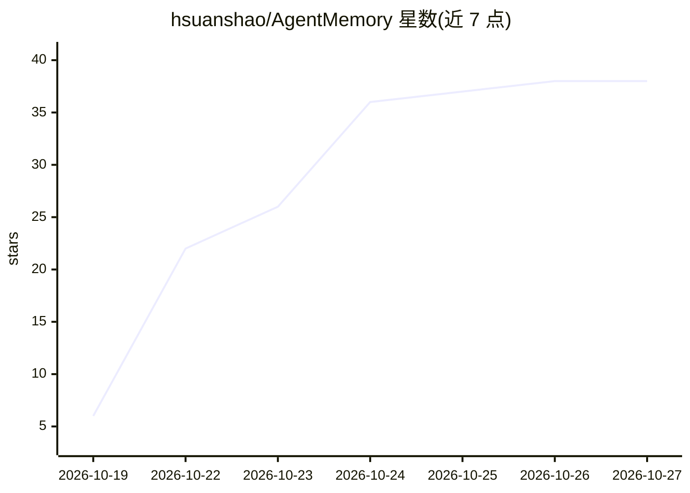

# hsuanshao/AgentMemory

⭐ 38 · Rust · NOASSERTION · 推送 2026-10-25 · [GitHub](https://github.com/hsuanshao/AgentMemory) · 个人维护 · 中文 README

**自托管的团队级 AI agent 长期记忆服务**

Rust 编写的自托管记忆服务：为 Claude Code、Codex、Antigravity、Hermes 及任意 MCP 客户端提供跨会话持久记忆。捕获对话后，在后台用 LLM 将原始轮次（L0）蒸馏为事实（L1）、场景（L2）与人格（L3），每次提示前通过 BM25+向量+RRF 混合检索召回相关记忆。支持部门/团队/成员隔离，存储可用 SQLite（默认）或 PostgreSQL（pgvector），蒸馏模型接任意 OpenAI 兼容端点或本地 CLI。提供 amem CLI、MCP 服务、监控面板与 Docker 安装脚本。

## 筛选速览

| 维度 | 判定 | 备注 |
|---|---|---|
| AI 角色 | `ai-ecosystem` | LLM/agent 周边工具 |
| 许可风险 | `none` | NOASSERTION |
| 部署形态 | `self-host` | docker 或自建部署 |
| 模型依赖 | — | README 未给出锁定关系 |
| 硬件要求 | — | 无带数字的原话,不猜 |
| 安装摩擦 | `low` | 无编译、无系统依赖或容器化 |
| 成熟度 | — | 结构信号不足 |

## 能力要点

- L0→L3 分层记忆：原始对话→事实→场景→人格的后台蒸馏
- BM25+向量+RRF 混合召回，无 embedding 时回退 BM25
- 部门/团队/成员三级隔离，成员事实私有、场景与人格共享
- SQLite 起步，可迁移至 PostgreSQL(pgvector)+Redis 扩展
- 任意 OpenAI 兼容端点或本地 CLI（claude/codex/agy）作蒸馏模型

## 适用场景

- 团队多个 AI agent 共享跨会话记忆且数据不出内网
- 为 Claude Code/Codex 等客户端接入统一的记忆与召回服务
- 运维侧通过监控面板查看蒸馏健康度与死信重试

## 场景标签

`Agent 记忆` · 领域:Agent 开发

## 证据(README 行号)

> L15: **Self-hosted, team-aware long-term memory for AI agents.** AgentMemory gives Claude Code, Codex, Antigravity, Herm
> L25: - **Memory that compounds.** Raw turns (L0) are distilled into facts (L1), consolidated into scenes (L2) and summar
> L30: - **One client for every agent.** The `amem` CLI plugs into Claude Code, Codex, Antigravity and Hermes hooks, and s

## 星数曲线

2026-10-19 6 → 2026-10-27 38（+32）

---
*卡片 v1 · prompt 1.4 · 生成 2026-10-25 · 置信度 high · 依据 README sha `eff7ae4dca51` · [字段定义](../../DATASET.md)*
