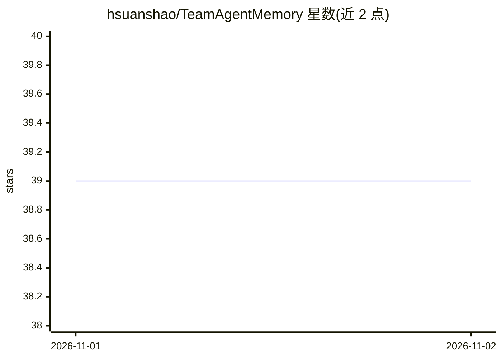

# hsuanshao/TeamAgentMemory

⭐ 39 · Rust · NOASSERTION · 推送 2026-10-31 · [GitHub](https://github.com/hsuanshao/TeamAgentMemory) · 个人维护 · 中文 README

**团队 AI agent 的自托管长期记忆服务，Rust 编写**

面向团队场景的自托管记忆服务器：为 Claude Code、Codex、Antigravity、Hermes 及任意 MCP 客户端提供跨会话持久记忆。采用 L0→L3 分层记忆（原始对话→事实→场景→persona），后台异步调用任意 OpenAI 兼容 LLM 或本地 CLI 做蒸馏，召回时组合 BM25 与向量检索（RRF 融合）。提供部门/团队/成员三级隔离，私有对话不出成员、共享场景与 persona 由团队共用。存储默认 SQLite，可扩展到 PostgreSQL+pgvector+Redis，通过 install.sh 与 Docker Compose 部署，含 Monitor Panel 与 amem CLI。许可为 BUSL-1.1。

## 筛选速览

| 维度 | 判定 | 备注 |
|---|---|---|
| AI 角色 | `ai-ecosystem` | LLM/agent 周边工具 |
| 许可风险 | `none` | NOASSERTION |
| 部署形态 | `self-host` | docker 或自建部署 |
| 模型依赖 | — | README 未给出锁定关系 |
| 硬件要求 | — | 无带数字的原话,不猜 |
| 安装摩擦 | `low` | 无编译、无系统依赖或容器化 |
| 成熟度 | — | 结构信号不足 |

## 能力要点

- L0→L3 分层记忆：对话→事实→场景→persona 的后台蒸馏
- BM25+向量混合召回（RRF k=60，无 embedding 时回退 BM25）
- 部门/团队/成员三级隔离，服务端授权层强制执行
- 中文全文检索用重叠 CJK bigram 分词，无需词典

## 适用场景

- 让团队的编程 agent 记住项目约定、决策与常见问题
- 每个成员保留私有对话，同时共享 agent 积累的团队上下文
- 在企业内网自托管记忆服务，数据不离开自己的服务器

## 场景标签

`Agent 记忆` · 领域:Agent 开发

## 证据(README 行号)

> L15: **Self-hosted long-term memory for teams that work with AI agents.** AgentMemory gives Claude Code, Codex, Antigrav
> L44: - **Your data stays with you.** Memory, database and even the distillation model can all run inside your network. T
> L46: - **Memory that compounds.** Raw turns (L0) are distilled into facts (L1), consolidated into scenes (L2) and summar

## 星数曲线

2026-11-01 39 → 2026-11-02 39（+0）

---
*卡片 v1 · prompt 1.4 · 生成 2026-10-31 · 置信度 high · 依据 README sha `dc7698d6c111` · [字段定义](../../DATASET.md)*
