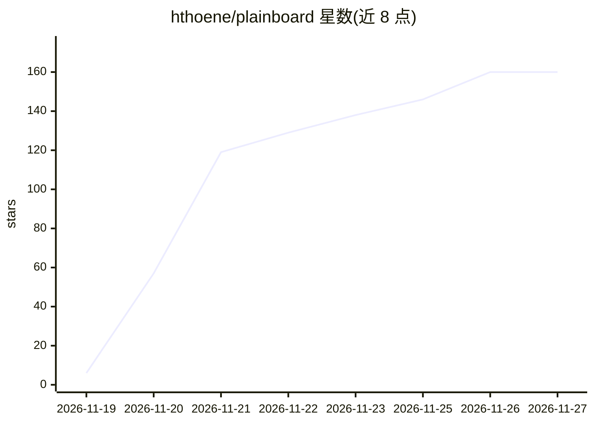

# hthoene/plainboard

⭐ 160 · Python · MIT · 推送 2026-11-26 · [GitHub](https://github.com/hthoene/plainboard) · 个人维护

**自托管多智能体团队：经理规划、专职智能体写软件**

PlainBoard 以看板形式组织一组 AI 智能体协作开发软件：用户与经理智能体对话或提交工单，经理拆解任务并分配给各专职智能体，完成的分支合并为一趟检查，通过后落入 main 分支。智能体在带 shell、sudo 与网络的独立容器内工作，密钥静态加密；等待 CI 时不消耗模型调用，长对话由低价模型摘要。通过 docker compose 一条命令启动，在浏览器中完成账号、模型与代码接入配置，支持多角色账户、MCP 服务器与手机端访问。

## 筛选速览

| 维度 | 判定 | 备注 |
|---|---|---|
| AI 角色 | `ai-native` | 本体是模型或模型工具 |
| 许可风险 | `permissive` | MIT |
| 部署形态 | `self-host` | docker 或自建部署 |
| 模型依赖 | local-ok | 支持本地模型 |
| 硬件要求 | — | 无带数字的原话,不猜 |
| 安装摩擦 | `low` | 无编译、无系统依赖或容器化 |
| 成熟度 | — | 结构信号不足 |

## 能力要点

- 经理智能体规划工单并分配给专职智能体协作开发
- 完成分支合并为一趟检查，通过即合入 main
- 智能体运行于独立容器，密钥静态加密
- 可接 Claude、Codex 及 Ollama/vLLM 等自建模型服务

## 适用场景

- 通过对话描述需求让智能体团队开发并合入软件
- 自托管管理多智能体开发任务与成本
- 团队多人按角色查看/参与智能体开发进度

## 场景标签

`多智能体` `编码 Agent` · 领域:Agent 开发

## 证据(README 行号)

> L5: You say what you want. A manager agent plans the work, specialised agents build it,
> L117: - **A team per project.** Each agent has a role, a model, an effort level and its own tools. Claude
> L126: - **Notes, schedules, MCP servers, git repositories.** All optional; without git everything works

## 星数曲线

2026-11-19 6 → 2026-11-27 160（+154）

---
*卡片 v1 · prompt 1.4 · 生成 2026-11-20 · 置信度 high · 依据 README sha `9c1e989f1a74` · [字段定义](../../DATASET.md)*
