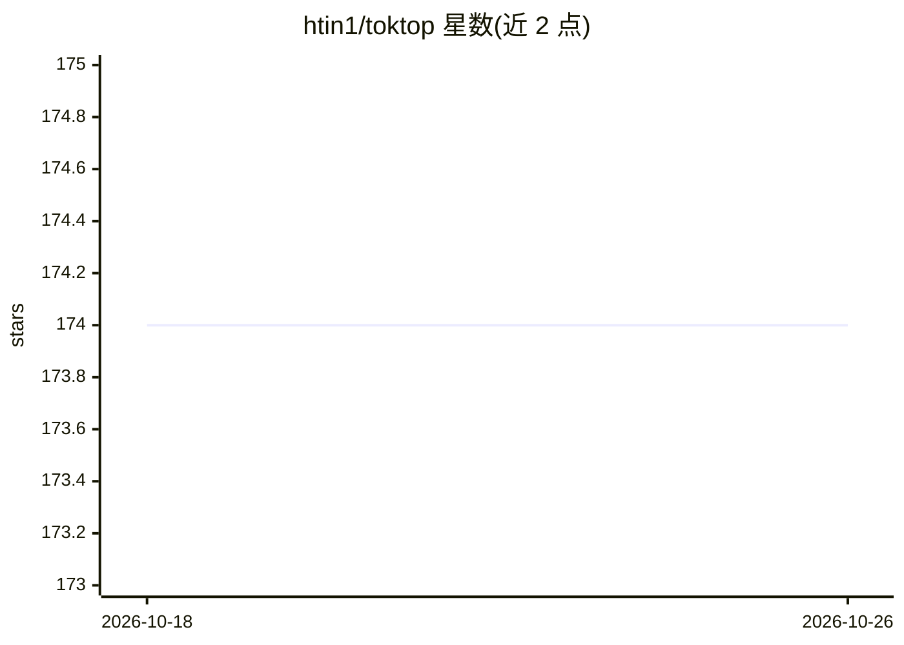

# htin1/toktop

⭐ 174 · Rust · MIT · 推送 2025-12-07 · [GitHub](https://github.com/htin1/toktop) · [官网](https://crates.io/crates/toktop) · 个人维护

**终端中监控 OpenAI/Anthropic token 用量与成本的 TUI 面板**

用 Rust 与 Ratatui 构建的终端仪表盘，供 OpenAI 和 Anthropic 账户管理员在终端内查看 token 用量与成本，无需切换到各厂商网页后台。通过设置 OPENAI_ADMIN_KEY 与 ANTHROPIC_ADMIN_KEY 环境变量，调用两家厂商的组织级成本与用量 API 拉取数据，支持按 Provider、指标、日期范围、分组维度切换，并可按 API Key 分组。作者表示 Gemini 与 Cursor 因 API 限制暂未支持。

## 筛选速览

| 维度 | 判定 | 备注 |
|---|---|---|
| AI 角色 | `ai-ecosystem` | LLM/agent 周边工具 |
| 许可风险 | `permissive` | MIT |
| 部署形态 | `library` | 以包/库形式分发 |
| 模型依赖 | — | README 未给出锁定关系 |
| 硬件要求 | — | 无带数字的原话,不猜 |
| 安装摩擦 | `low` | 无编译、无系统依赖或容器化 |
| 成熟度 | — | 结构信号不足 |

## 能力要点

- 读取 OpenAI/Anthropic 组织级成本与用量 API
- 按 Provider/指标/日期范围/分组维度交互切换
- 支持按 API Key 名称分组统计
- 基于 Ratatui 的终端界面，cargo install 一键安装

## 适用场景

- 在终端里随时查看 OpenAI/Anthropic 账户花费
- 按 API Key 或项目维度分析用量分布
- 避免频繁登录各厂商控制台核对账单

## 场景标签

`LLM 可观测性` · 领域:评测与运维

## 证据(README 行号)

> L16:  htop but for llm tokens
> L27: toktop is a terminal-based dashboard for OpenAI and Anthropic token usage and costs. It allows user (admin of their

## 星数曲线

2026-10-18 174 → 2026-10-26 174（+0）

---
*卡片 v1 · prompt 1.4 · 生成 2026-10-23 · 置信度 high · 依据 README sha `dbdfde8a141c` · [字段定义](../../DATASET.md)*
