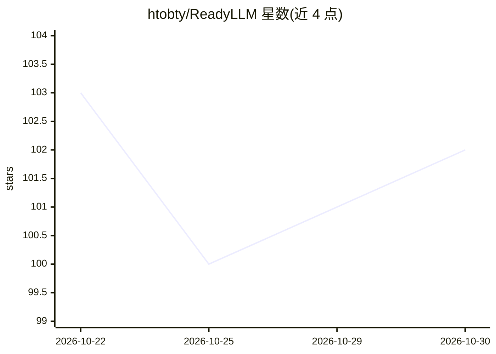

# htobty/ReadyLLM

⭐ 102 · Python · MIT · 推送 2026-10-22 · [GitHub](https://github.com/htobty/ReadyLLM) · 个人维护 · 中文 README

**通过可视化界面部署、监控与调优本地 LLM 的 Web 工具**

FastAPI + React 构建的本地及局域网 LLM 部署管理工具：以"目标机"（本机或 SSH 远程）为单位管理推理引擎（llama.cpp/vLLM/SGLang/ComfyUI），探测硬件并推荐适配模型，从 HuggingFace/ModelScope/hf-mirror 三源下载模型并校验完整性。提供 GPU/吞吐/延迟的 WebSocket 实时监控、两阶段参数自动调优、可接入自有 LLM API 的 AI Agent 调优，以及在 ComfyUI 之上的文生图/文生视频面板。限制：vLLM 在 Windows 需经 WSL2 运行。

## 筛选速览

| 维度 | 判定 | 备注 |
|---|---|---|
| AI 角色 | `ai-ecosystem` | LLM/agent 周边工具 |
| 许可风险 | `permissive` | MIT |
| 部署形态 | `library` | 以包/库形式分发 |
| 模型依赖 | local-ok | 支持本地模型 |
| 硬件要求 | — | 无带数字的原话,不猜 |
| 安装摩擦 | `medium` | 含编译或系统依赖之一 |
| 成熟度 | — | 结构信号不足 |

## 能力要点

- 统一目标机管理：本机或 SSH 远程，自动探测 OS 与 GPU/显存/内存
- 一键部署 llama.cpp/vLLM/SGLang，引擎缺失时可自动下载/编译安装
- 两阶段参数自动调优（延迟/吞吐/prefill 目标）+ LLM 驱动的 Agent 调优
- 基于 ComfyUI 的文生图、文生视频、分镜生成与 AI 超分

## 适用场景

- 给本地或局域网多台机器统一部署和运行 LLM 推理服务
- 不知道模型该用什么参数时做自动调优并实时监控性能
- 在同一个界面里同时管理文本模型和 ComfyUI 图像/视频生成

## 场景标签

`推理引擎` `图像生成` `视频生成` · 领域:内容生成

## 证据(README 行号)

> L7: Deploy, monitor, and tune large language models through a visual interface — plus image / video generation on top of
> L57: - **One-click deployment**: start / stop inference services (llama.cpp, vLLM, SGLang) with manually tweakable runti

## 星数曲线

2026-10-22 103 → 2026-10-30 102（-1）

---
*卡片 v1 · prompt 1.4 · 生成 2026-10-23 · 置信度 high · 依据 README sha `84957d058db4` · [字段定义](../../DATASET.md)*
