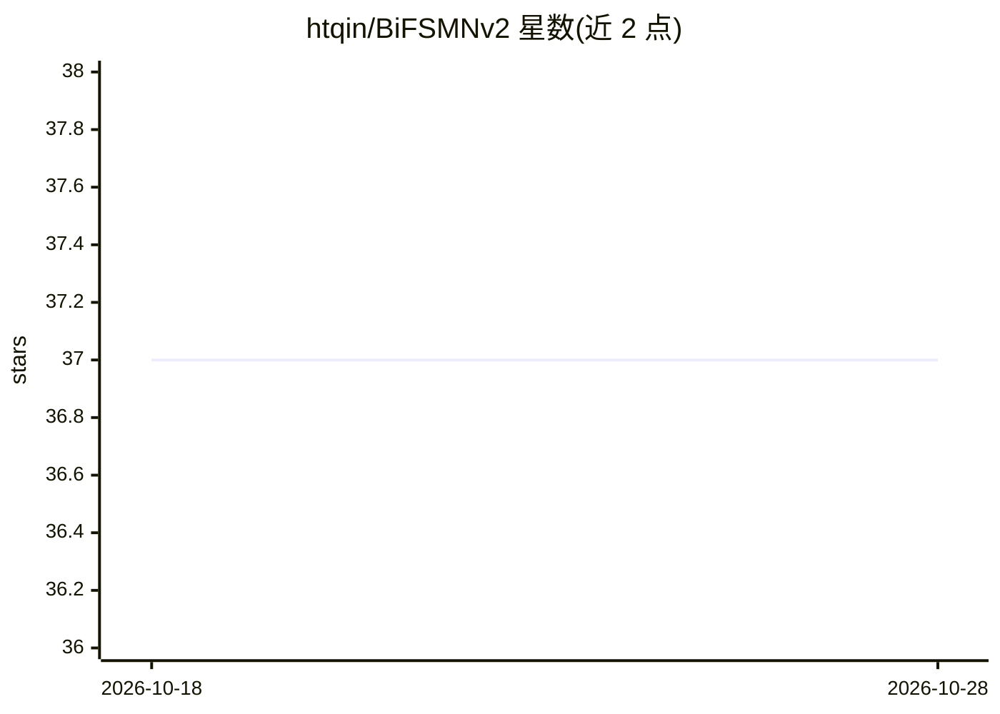

# htqin/BiFSMNv2

⭐ 37 · Python · 推送 2026-09-11 · [GitHub](https://github.com/htqin/BiFSMNv2) · 组织维护 · 中文 README

**二值神经网络关键词检出模型 BiFSMNv2 的 PyTorch 实现**

IEEE TNNLS 2024 论文的官方 PyTorch 实现：BiFSMNv2 是用于关键词检出的二值网络，结合双尺度可剪裁结构、频率独立蒸馏（FID）与可学习二值化器（LPB），权重/激活为 1-bit，保留部分全精度操作，支持精度/延迟权衡。训练与测试基于 Google Speech Commands V1/V2，蒸馏需自备全精度教师模型（README 未提供下载链接）。部署实验为 Raspberry Pi 3B+ ARMv8 上的论文结果，未在仓库中新复现。作者来自北航、字节跳动 AI Lab 与中关村实验室。

## 筛选速览

| 维度 | 判定 | 备注 |
|---|---|---|
| AI 角色 | `ai-native` | 本体是模型或模型工具 |
| 许可风险 | `none` | — |
| 部署形态 | `None` |  |
| 模型依赖 | — | README 未给出锁定关系 |
| 硬件要求 | — | 无带数字的原话,不猜 |
| 安装摩擦 | `low` | 无编译、无系统依赖或容器化 |
| 成熟度 | — | 结构信号不足 |

## 能力要点

- 1-bit 权重/激活的二值关键词检出网络，保留敏感全精度操作
- 双尺度可剪裁结构支持 full/half/quarter 运行时深度选择
- FID 分离蒸馏低/高频信息，LPB 前向/反向学习二值化行为
- 论文报告 quarter 变体 25.1× 加速与 20.2× 存储节省（ARMv8 优化核）

## 适用场景

- 在 Speech Commands V1/V2 上训练二值关键词检出模型
- 在 ARM 嵌入式设备上研究低比特模型的精度/延迟权衡
- 复现 TNNLS 论文中的二值网络实验结果

## 场景标签

`模型量化` · 领域:训练与推理

## 证据(README 行号)

> L1: # BiFSMNv2: Pushing Binary Neural Networks for Keyword Spotting to Real-Network Performance
> L9: **BiFSMNv2 is a binary keyword-spotting network combining dual-scale thinnable architecture, Frequency Independent D
> L43: We train and test BiFSMNv2 on Google Speech Commands V1 and V2 datasets, which can be downloaded in the reference d

## 星数曲线

2026-10-18 37 → 2026-10-28 37（+0）

---
*卡片 v1 · prompt 1.4 · 生成 2026-10-25 · 置信度 high · 依据 README sha `c23b1805556b` · [字段定义](../../DATASET.md)*
