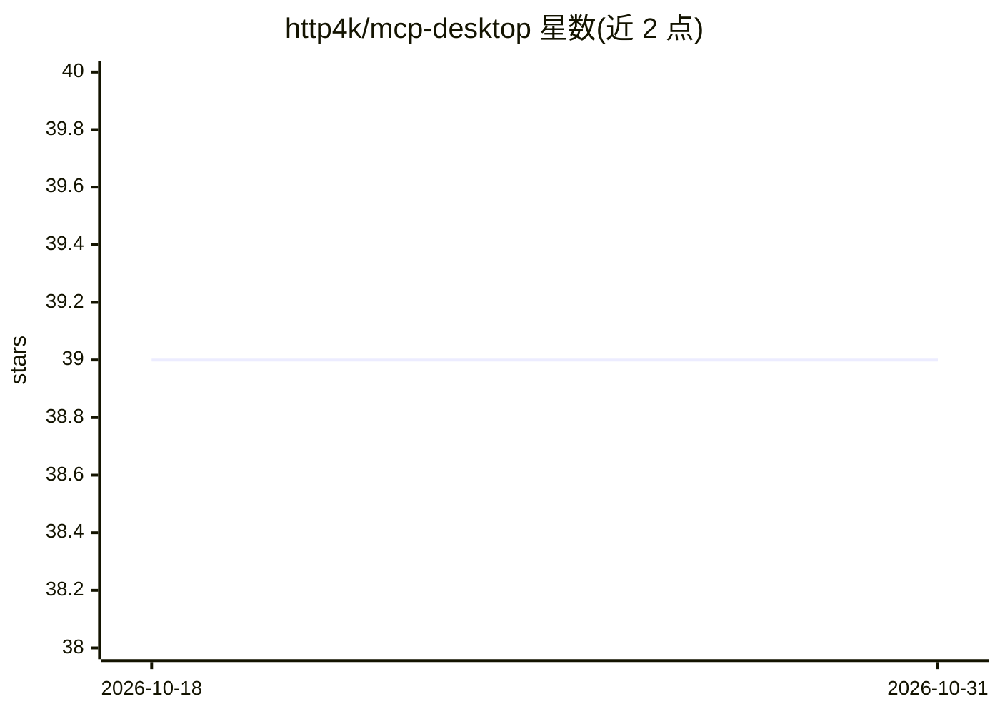

# http4k/mcp-desktop

⭐ 39 · Kotlin · NOASSERTION · 推送 2026-09-29 · [GitHub](https://github.com/http4k/mcp-desktop) · [官网](https://mcp.http4k.org) · 组织维护

**连接远程 MCP 服务器的 StdIO 桌面客户端（CLI）**

命令行形式的桌面客户端/代理，通过标准输入输出（StdIO）桥接 Claude 等桌面 AI 应用与远程 MCP 服务器：读取应用 stdin 输入转发至服务器，将响应经 stdout 返回。支持 HTTP Streaming、SSE、JSON-RPC、WebSocket 等多种远程传输方式，以及 API Key、Bearer Token、Basic Auth、OAuth（自动发现）四种认证机制，可配置重连延迟。对基于 http4k MCP SDK 构建的服务器做了专门适配，另可通过 Homebrew 或 GitHub Releases 安装。注意：采用 http4k Commercial License，非商业/非营利用途免费。

## 筛选速览

| 维度 | 判定 | 备注 |
|---|---|---|
| AI 角色 | `ai-ecosystem` | LLM/agent 周边工具 |
| 许可风险 | `none` | NOASSERTION |
| 部署形态 | `None` |  |
| 模型依赖 | — | README 未给出锁定关系 |
| 硬件要求 | — | 无带数字的原话,不猜 |
| 安装摩擦 | `low` | 无编译、无系统依赖或容器化 |
| 成熟度 | — | 结构信号不足 |

## 能力要点

- StdIO 与远程 MCP 服务器之间的代理桥接
- 5 种远程传输模式（HTTP Streaming/Non-streaming、SSE、WebSocket、JSON-RPC）
- 4 种认证机制：API Key、Bearer Token、Basic Auth、OAuth 自动发现
- 针对 http4k MCP SDK 构建的服务器专门优化

## 适用场景

- 让 Claude Desktop 等桌面 AI 应用连接远程 MCP 服务器
- 通过 Cursor 使用时以 HTTP Non-streaming 模式接入 MCP 服务器
- 为托管/分布式 MCP 服务器选择 WebSocket 或 JSON-RPC 传输

## 场景标签

 · 领域:AI 基础设施/MCP 客户端

## 证据(README 行号)

> L5: A command-line desktop client for connecting to MCP (Model Context Protocol) servers via standard input/output (StdI
> L10: The http4k MCP Desktop Client serves as a proxy that enables communication between desktop applications and MCP ser
> L128: This client is specifically designed to work with desktop AI applications that use StdIO for communication. It han

## 星数曲线

2026-10-18 39 → 2026-10-31 39（+0）

---
*卡片 v1 · prompt 1.4 · 生成 2026-10-25 · 置信度 high · 依据 README sha `a606c8ec220a` · [字段定义](../../DATASET.md)*
