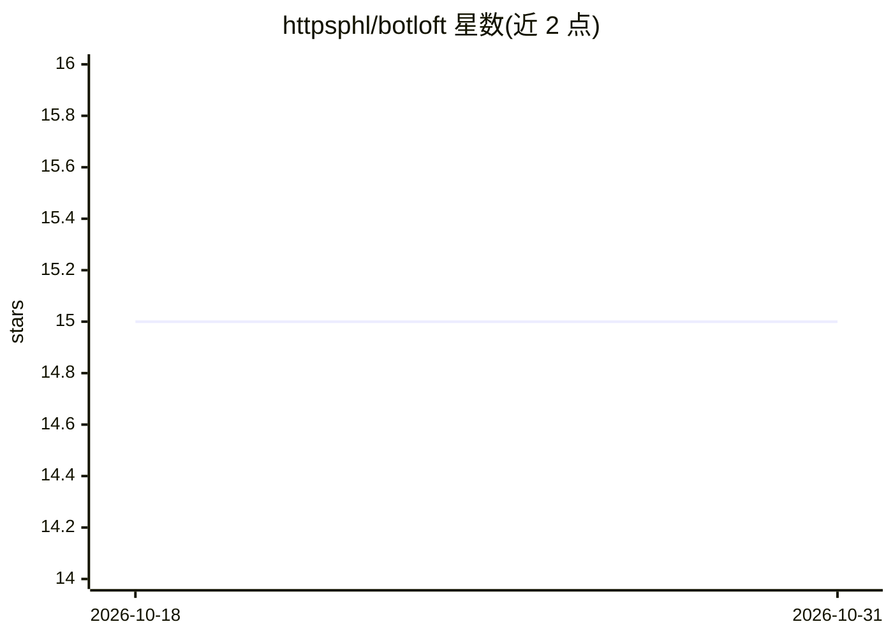

# httpsphl/botloft

⭐ 15 · Rust · NOASSERTION · 推送 2026-10-29 · [GitHub](https://github.com/httpsphl/botloft) · [官网](https://github.com/httpsphl/botloft/releases/latest) · 个人维护

**本地常驻多 AI 编码 agent 编排桌面应用（Claude Code/Antigravity/Codex）**

Tauri+React 桌面应用配合 Rust 守护进程 botloftd，在用户电脑上常驻运行一组 AI 编码 agent：每个 agent 是所选引擎（Claude Code 为主，Antigravity/Codex 为实验选项）的真实会话进程，拥有独立文件夹、记忆与会话，可互相传递任务、按 cron 计划例行运行、关窗后继续工作并支持重启恢复。提供逐 agent 权限确认、实时浏览器观看、Windows 桌面应用操作（实验性）、手机端经端到端加密远程访问。无自研 agent SDK，需用户自带引擎账号；本地 SQLite 存储，监听 127.0.0.1，无遥测。提供 Windows/Linux/macOS 安装包。

## 筛选速览

| 维度 | 判定 | 备注 |
|---|---|---|
| AI 角色 | `ai-ecosystem` | LLM/agent 周边工具 |
| 许可风险 | `none` | NOASSERTION |
| 部署形态 | `desktop` | 安装包/桌面程序 |
| 模型依赖 | — | README 未给出锁定关系 |
| 硬件要求 | — | 无带数字的原话,不猜 |
| 安装摩擦 | `low` | 无编译、无系统依赖或容器化 |
| 成熟度 | `idea` | |

## 能力要点

- agent 为引擎真实会话进程（claude -p / agy -p / codex app-server），无自研 SDK 与 API key
- 守护进程 botloftd 常驻：agent 互相传递任务、按 cron 例行运行、关窗与重启后继续
- 逐 agent 权限控制（执行前询问/自动决策）、实时浏览器观看与代登录
- 手机经端到端加密远程审批与聊天；备份文件云同步但服务端不可读

## 适用场景

- 在本地持续运行一组 AI 编码 agent 协作完成目标
- 夜间或离线时按计划自动执行例行任务
- 从手机远程审批 agent 请求并继续对话

## 场景标签

`多智能体` `编码 Agent` · 领域:Agent 开发

## 证据(README 行号)

> L156: - **Your engine is the runtime.** Each agent is a real session of the engine you chose (`claude -p` for
> L158:  own workspace, memory and conversation. There is no custom agent SDK and no API key to manage.

## 星数曲线

2026-10-18 15 → 2026-10-31 15（+0）

---
*卡片 v1 · prompt 1.4 · 生成 2026-10-30 · 置信度 high · 依据 README sha `fd93886036d5` · [字段定义](../../DATASET.md)*
