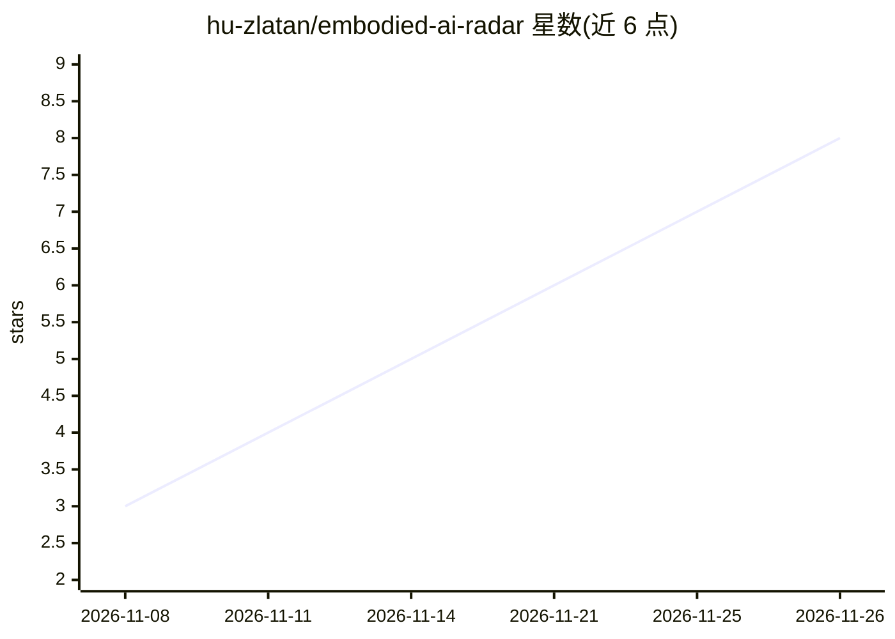

# hu-zlatan/embodied-ai-radar

⭐ 8 · Python · MIT · 推送 2026-11-25 · [GitHub](https://github.com/hu-zlatan/embodied-ai-radar) · [官网](https://embodied-ai-radar.com/) · 个人维护 · 中文 README

**给具身智能研究者提供每日更新的中英双语论文/代码/数据集导航**

具身智能与机器人学习领域的双语聚合站点与策展清单：人工核验的论文、代码、数据集、仿真器与硬件条目，每条附一行中英文摘要；GitHub Action 每日自动拉取 arXiv cs.RO 等类目新论文并按主题打标。提供即时搜索、按主题/机器人形态/会议过滤、代码仓库追踪（star 数与许可）、curated.json/csv 可下载索引、一键 BibTeX 以及从基础到硬件的 41 条阅读路径。以静态网站形式提供，内容采用 MIT + CC BY 4.0 许可。

## 筛选速览

| 维度 | 判定 | 备注 |
|---|---|---|
| AI 角色 | `ai-knowledge` | 知识聚合/清单类 |
| 许可风险 | `permissive` | MIT |
| 部署形态 | `None` |  |
| 模型依赖 | — | README 未给出锁定关系 |
| 硬件要求 | — | 无带数字的原话,不猜 |
| 安装摩擦 | `low` | 无编译、无系统依赖或容器化 |
| 成熟度 | — | 结构信号不足 |

## 能力要点

- 每日自动拉取 arXiv 机器人新论文并按主题打标
- 策展条目人工核验，链接由 CI 每周检查
- curated.json/csv 下载（CC BY 4.0）与 curated.bib 引用打包
- 中英双语摘要与站点语言切换

## 适用场景

- 追踪具身智能领域每日新论文
- 按 VLA、操作、腿足等主题查找已核验的论文与代码
- 入门者按 10 步阅读路径系统学习
- 下载结构化索引构建自己的工具

## 场景标签

`精选清单` `教程课程` · 领域:学习与行业

## 证据(README 行号)

> L3: **A bilingual (English / 中文), always-fresh map of embodied AI and robot learning.**
> L22: - **Fresh.** A GitHub Action pulls new cs.RO papers (plus robotics papers from cs.CV / cs.LG / cs.AI / cs.CL) every
> L40: ## Curated index

## 星数曲线

2026-11-08 3 → 2026-11-26 8（+5）

---
*卡片 v1 · prompt 1.4 · 生成 2026-11-21 · 置信度 high · 依据 README sha `b46b3f229106` · [字段定义](../../DATASET.md)*
